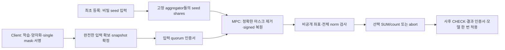

# 고정 Committee의 Single-mask Seed-MPC 연합학습 프로토콜

> 2026-10-11 마스크 경로 갱신: 현재 기본 구현은 [seed 기반 component 로컬 확장](aion-seeded-components-protocol.md)이다. 아래의 비밀 키 AES 생성식은 `secret-aes-v1` 이전 경로를 설명한다. 바운더리 검사·wrap 복원·wide SUM·인증·dropout 계약은 새 경로에도 적용된다.

작성일: 2026-10-11  
작업 위치: WSL Ubuntu-24.04, `/home/hacho/@WSL-Projects/trustlessFL`  
브랜치: `work/aion-private-bound-no-wrap`

이 문서는 현재 사용하는 Rep4 프로토콜과 최근 합의한 client dropout 처리 설계를 정리한다. **Aggregator committee는 세션 중 변경하지 않는다.** 기존 소수 필드/HPRF 후보의 설계 변천은 [이전 설계 문서](aion-seed-mpc-protocol.md)에 남기고, 현재 계약은 이 문서를 기준으로 읽는다.

등록부터 학습·마스킹·비공개 검사·집계·wrap 증명·프라이버시 한계까지의 수식 설명은 [전체 과정의 수식 해설](aion-seed-mpc-math-walkthrough.md)에 정리했다.

현재 코드에는 single mask, 최초 seed 공유, 비공개 바운더리 검사, 정확한 정수 집계, 입력·결과 인증 및 Flower 연결이 구현돼 있다. 전체 FMNIST/LeNet5의 실제 IID 5라운드를 검증했다. 이후 v2 가변 제출·수신증명·영속 마감·atomic close에 이어 **Flower의 마감별 입력 수집, ACK 없이 진행하는 결과 전달, 복귀 client의 인증 체인 동기화**를 구현했다. 실제 Flower/Ray·Rep4의 10라운드 합성 dropout fixture와 정상 경로 회귀를 검증했다. 등록/round/종료 비용도 별도 observer build와 실제 Flower 경로에서 계측했다. [Dropout 구현 기록](reproduction/seed-mpc-v2-dropout-2026-10-11.md), [통신 계측 기록](reproduction/seed-mpc-meter-2026-10-11.md). 전체 FMNIST dropout 재학습·전체 차원 계측, 역할 격리는 남아 있다.

## 1. 목적과 적용 범위

다음 성질을 목표로 한다.

1. 여러 aggregator가 분산 검사·집계를 수행한다.
2. 개별 업데이트를 aggregator나 coordinator에게 평문으로 전달하지 않는다.
3. 악성 client가 제출한 입력도 MPC 내부에서 정적 좌표·norm 바운더리를 검사한다.
4. 전송 공간의 carry/wrap 때문에 집계 값이 달라지지 않는다.
5. 마스크 벡터 대신 작은 생성키를 최초 한 번 공유하고 같은 세션에서 재사용한다.
6. Client별 single mask를 사용한다.

정확성 대상은 승인된 **양자화 정수 업데이트**다. 실수 학습의 양자화 오차와 전송·계산 공간의 wrap 오류를 구분한다. Norm 안의 악성 업데이트나 실제 SGD 수행 여부를 판별하는 것은 목표에 포함하지 않는다. Client가 별도 ZKP를 생성하는 단계는 없다.

V1 snapshot은 전원 입력을 요구한다. V2 Flower는 마감까지 완전한 입력과 수신증명을 확보한 부분집합을 snapshot에 고정하며 전원 client ACK를 요구하지 않는다. 초기 seed 등록과 native aggregator 실행은 여전히 전원이 필요하다.

## 2. 참여자와 신뢰 모델

| 역할 | 수행 내용 | 보유하는 정보 |
|---|---|---|
| 학습 client \(C_i\) | 모델 검증, 로컬 학습, 양자화, 마스킹, 서명 | 자신의 데이터·업데이트·seed |
| 고정 aggregator \(A_0,\ldots,A_3\) | 입력 검증·확정, Rep4 MPC, 결과 투표 | 등록 seed의 secret shares, 공개 masked 입력·인증서 |
| Flower coordinator | 모델 배포, 입력 전달, 인증서 수집, 인증 모델 적용 | 공개 모델·masked 입력·참여 명단·결과 |

Aggregator는 정확히 4개이고, 세션 전체에서 **static 최대 1개 악성 aggregator**를 가정한다. Rep4의 malicious-security 계약에 의존하며 악성 동작으로 계산이 중단될 수 있다. 2개 aggregator의 공모는 이 프라이버시 계약 범위 밖이며 seed shares를 복원할 수 있다. Committee가 고정이라는 가정은 모든 aggregator가 항상 연결된다는 뜻은 아니다. 현재 native 경로는 4개 party의 실행을 필요로 한다.

현재 backend는 **MP-SPDZ 0.4.3의 malicious Rep4**다. [공식 보안 설명](https://mp-spdz.readthedocs.io/en/latest/security-fixes.html#insufficient-checks-in-rep4)에 지연된 consistency check를 이용한 selective-failure 취약점이 기록돼 있으며, [0.4.3 릴리스](https://github.com/data61/MP-SPDZ/releases/tag/v0.4.3)에 해당 수정 포함이 명시돼 있다. 2026-10-11 로컬 `Protocols/Rep4.hpp`와 `Protocols/Rep4MC.hpp`를 공식 v0.4.3 태그와 비교해 주석·공백을 제외한 내용의 일치를 확인했다. 수정된 backend와 올바른 보안 설정을 전제로 하며, application이 마지막 CHECK 뒤 서명한다는 규칙만으로 backend의 지연 검사 취약점을 해결한다고 주장하지 않는다. 이 두 파일 비교는 전체 실행 binary의 provenance나 전체 프로토콜 보안 증명을 대신하지 않는다.

Client 입력은 신뢰하지 않는다. Coordinator의 입력·결과 조작은 서명, 동일 snapshot 검사, durable lock과 결과 quorum 검증으로 방어한다. **3개 서명의 인증서는 전체 BFT 구현과 다르다.** View change, pacemaker 및 장애 중 진행 보장은 구현하지 않았다.

Aggregator의 독립 운영·저장소 보호를 전제로 한다. 현재 시험은 같은 WSL/Unix UID에서 수행한 기능 검증이다. 악성 client와 aggregator의 공동 공모를 포함한 등록부터 출력까지의 전체 합성 보안 증명은 아직 완료하지 않았다.

현재 로컬 배치에서는 client의 `client.json`과 시험용 raw audit이 mode 0600이지만 서버와 같은 UID 소유다. 따라서 동일 OS 사용자 권한의 서버 process가 이 파일을 읽는 것을 막지 못한다. ServerApp API가 비밀값을 받지 않는다는 것과 파일·메모리 접근 격리는 별개의 성질이다. 실제 비신뢰 서버 배치에는 client/aggregator의 독립 실행·권한 경계와 시험용 raw audit 제거가 필요하다. 같은 호스트의 OS 관리자 권한을 가진 공격자까지 현재 프로토콜이 보호한다고 주장하지 않는다.

## 3. 공개값과 비밀값

공개값은 등록 identity/handle, 세션·정책·모델·라운드 context, signed masked 업데이트, 입력 snapshot과 인증서, 성공 시 selected SUM/count 및 새 모델이다. Dropout 확장에서는 제출 여부도 공개 참여집합에 포함한다.

MPC 내부에 비밀로 유지하는 값은 client seed, 생성된 mask, 복원된 개별 업데이트, norm, 바운더리 통과 비트다. 별도의 signed sum, 개별 norm·score, 합계 mask나 key를 공개하지 않는다.

개별 통과 비트는 직접 열지 않지만, **허용된 count/ok로부터 추론되는 정보도 누출 범위에 포함한다.** 현재 제출자 4명에서 count=4이면 모두 통과했음을 알 수 있고, abort이면 실제 통과 인원이 2명 미만임을 알 수 있다. 허용된 SUM 및 공격자가 아는 입력으로부터의 추론도 별도로 남는다.

성공 시 기본 출력은

\[
U_r=\sum_i e_{i,r}u_{i,r},\qquad a_r=\sum_i e_{i,r}
\]

및 이 결과에 대한 인증서다. \(a_r<a_{\min}\)이면 API에는 `abort`만 전달한다. 현재 native 회로는 `ok=0`과 0으로 가린 count/SUM을 출력하고 adapter가 실제 SUM/count를 노출하지 않는 abort 결과로 변환한다.

허용한 합계 자체의 추론은 MPC가 제거하지 않는다. 공모자가 알려진 기여를 빼고 남는 honest 입력이 하나라면 그 입력이 드러날 수 있다. \(a_{\min}=2\)는 honest client 2명의 참여를 보장하지 않는다. 원래 Aion의 client 공모 허용 범위와 동일한 전체 보안을 달성했다고 주장하지 않는다.

## 4. 고정 정책과 세 가지 공간

| 기호 | 의미 | 현재 FMNIST 값 |
|---|---|---:|
| \(D\) | 업데이트 좌표 수 | 61706 |
| \(n_{\max}\) | 등록 client slot 수 | 4 |
| \(S\) | 양자화 scale | 10000 |
| \(B\) | 정수 좌표 절댓값 상한 | 20000 |
| \(\tau\) | 정적 squared-L2 threshold | 2500000000 |
| \(w,Q\) | 전송 word 폭·modulus | 16, 65536 |
| \(a_{\min}\) | 최소 통과 인원 | 2 |
| \(K\) | MPC 산술 링 폭 | 64 |

공간을 다음처럼 구분한다.

- 실수 학습 공간: \(\Delta_i\)와 모델 파라미터.
- 전송·마스크 공간: \(\mathbb Z_Q\). Client는 좌표마다 unsigned 16비트 residue를 보낸다.
- MPC 집계 공간: \(\mathbb Z_{2^{64}}\). 허용된 작은 signed 정수와 중간값을 충분한 폭으로 계산한다.

\(\tau=25S^2\)는 **양자화 업데이트**의 L2 반경 5에 해당한다. 좌표 제한은 \(B/S=2\)이며 norm 제한과 함께 적용한다. 모델이나 최근 업데이트에 따라 threshold를 동적으로 바꾸지 않는다. Real-valued 업데이트에 대한 정확한 norm 판정과 양자화 업데이트의 판정은 동일한 명제가 아니다.

정책은 세션 전에 고정하고 policy hash, execution hash와 등록 계약에 묶는다. MPC 회로, bytecode, native binary와 AES circuit의 hash를 pin한다. 같은 실행 계약의 회로를 한 번 컴파일해 여러 라운드의 입력에 사용한다. 원본 Aion의 큰 HPRF modulus를 사용하지 않는다. 작은 \(Q\)와 최종 정수 합의 공간을 분리한다.

## 5. 최초 등록과 seed 유지

각 client는 세션 전용 독립 AES-128 key \(k_i\)와 서명 identity를 갖는다. 공개 등록 descriptor는 세션, 고정 committee epoch, client identity/slot, key handle, policy hash, execution hash를 포함한다.

Private 입력 채널을 통해 \(k_i\)를 2개의 full-width 64비트 word로 Rep4에 최초 한 번 입력한다. 어느 aggregator에게도 전체 key를 평문으로 맡기지 않는다. 등록 과정은 Rep4 input triples의 replicated component 일치와 곱 관계, 각 party가 받은 blinded 응답의 full-width 일치, descriptor hash binding을 검사한다. 입력 검사와 native CHECK를 완료한 뒤에만 handle을 사용한다.

**기존 Aion의 독립 Feldman VSS를 그대로 사용한 구현은 아니다.** 일관된 비밀 키 입력은 현재 Rep4 private-input 경로로 구성한다. Mask 벡터를 매 라운드 공유하지 않고 등록된 key의 secret shares를 native MPC 메모리에 유지한다. 공개 bit commitment로 AES key를 증명하는 구조도 아니다.

Committee는 세션 중 고정이다. Key shares 재사용은 **동일하게 계속 실행 중인 native 세션**에 한정한다. Triple/daBit 등 소비성 전처리 자원은 재사용하지 않는다. 안전한 secret-share disk 복구는 미구현이며, aggregator 상태 유실·불확실한 재시작에는 새 세션과 fresh client keys를 사용하는 현재 제한이 남는다.

## 6. Client 업데이트와 single mask

Client는 인증된 공개 모델과 다음 round를 확인한 뒤 학습한다. 현재 LeNet5에서는 float64 공개 모델을 실제 float32 Torch 파라미터로 로드하고, 학습 전후 실제 파라미터의 차이를 \(\Delta_i\)로 정의한다.

\[
u_{i,j}=\operatorname{RoundEven}(S\Delta_{i,j}).
\]

좌표 mask는 distinct AES counter에서 얻는다.

\[
\operatorname{ctr}(r,b)=\operatorname{uint64}_{BE}(r)\parallel
\operatorname{uint64}_{BE}(b),\qquad
Z_{i,r,b}=\operatorname{AES128}_{k_i}(\operatorname{ctr}(r,b)).
\]

AES 출력의 big-endian 16비트 word를 \(m_{i,r,j}\)로 사용한다. Block 하나가 8좌표를 만든다. Native SIMD 처리의 32좌표 chunk 마지막 padding은 framing용 0이며 실제 업데이트 좌표에 포함하지 않는다.

\[
Y_{i,r,j}=(u_{i,r,j}+m_{i,r,j})\bmod Q.
\]

Client는 \(Y_i\)를 현재 32좌표 단위로 서명하여 보낸다. 각 메시지에 session/epoch/round, 전체 model hash, policy hash, identity/handle, D/w, offset과 values를 포함한다. 다른 client와 pairwise mask를 교환하지 않는다.

AES framing은 unsigned 64비트 round를 담지만 현재 native·입력 인증 계약에서 허용하는 범위는 \(1\le r<2^{63}\)이다. Counter가 소진되면 fresh key의 새 세션을 사용한다.

같은 `(key, round, block)`을 다른 입력에 사용하면 안 된다. 현재 client ledger는 학습 context를 먼저 예약하고 완료된 요청에는 동일 캐시 ciphertext를 재전송한다. 결과가 불확실한 동일 round의 재학습·마스크 재사용은 거부한다. 늦은 입력을 새 round의 입력으로 재해석하지 않는다.

## 7. 입력 수집과 참여집합 확정

### 7.1 V1 전원 제출 경로

현재는 등록된 4개 client의 전체 masked 업데이트가 모두 필요하다. Coordinator와 각 aggregator는 모든 서명, context/handle, 좌표 수, offset 순서 및 누락·중복·겹침을 검증한다. 하나라도 전체 D좌표가 완성되지 않으면 snapshot을 만들지 않는다.

Snapshot에는 context, 이전 결정 hash, 계약 hash와 **정렬된 실제 signed 입력 전체**가 들어간다. 집합 명단이나 hash만 확보한 상태로 확정하지 않는다. Aggregator는 동일 snapshot의 입력을 확보·검증하고 durable lock을 기록한 뒤 input vote를 반환한다. 서로 다른 aggregator 3개 이상의 같은 body 서명이 input certificate를 구성한다. 현재 orchestration은 4개의 응답을 모두 수집한다.

MPC에 들어가는 round·snapshot digest·masked 값은 각 party가 동일하게 가져야 한다. Native에서는 4개 사본을 full-width 비교한다. 3개 서명이 있다는 사실만으로 누락된 native party에 데이터가 전달됐다고 간주하지 않는다.

### 7.2 V2 가변 제출 snapshot과 수집·확정

V2는 canonical presence 벡터와 등록 slot/client/handle에 결합된 absence marker를 snapshot에 넣는다. Present slot의 전체 signed 입력만 보관하고 absent slot은 canonical 0 dummy wire로 runtime을 구성한다. v2 등록·계약·vote와 native stream version을 사용해 v1과 혼용하지 않는다. Native에서 full-width 사본 일치와 0/1 검사 및 contribution/count gating을 수행한다. 현재 Flower orchestration의 기본 경로는 여전히 v1 전원 참여다.

등록 client 집합 \(R\)는 고정하고, 라운드마다 업로드 마감 시점까지 **완전하고 유효한 메시지를 제출한 집합** \(P_r\subseteq R\)를 확정한다. 공개 제출 비트를

\[
p_{i,r}=\mathbf 1[i\in P_r]
\]

로 정의한다. \(p_i\)는 제출 여부이며 norm 통과 여부가 아니다.

확정 시점에 필요한 재료는 다음과 같다.

1. 참여 client의 검증 완료된 seed shares와 등록 handle.
2. 참여 client의 전체 signed masked 업데이트와 해당 context.
3. 고정된 제출 비트·정렬된 참여집합·입력 내용에 대한 digest.
4. 현재/이전 모델·정책·출력 계약과 이전 결정 hash.

**참여집합 확정은 곧 이 재료의 snapshot 확정이다.** 이후 실행할 aggregator들이 실제 입력을 확보할 수 있어야 한다. 단독 coordinator가 hash만 남기고 입력을 보관하지 않는 상태는 실행 가능한 확정이 아니다. 입력 수신·보관·전달과 동일 snapshot 검증을 확인해야 한다.

확정 후 새로 도착한 업데이트를 끼워 넣거나, 업로드한 client가 연결을 끊었다는 이유로 그 입력을 제거하지 않는다. 같은 round/counter로 입력·참여집합·threshold를 바꿔 다시 집계하지 않는다. 부분 업로드는 해당 client 전체를 미제출로 처리한다.

미제출 slot은 인증된 \(p_i=0\)과 명시적 absence 표현을 사용한다. 각 presence 값은 canonical 0 또는 1인지 전체 폭에서 확인한다. 필요한 dummy wire/padding은 회로 framing용이다. **Masked 입력 0을 실제 업데이트 0으로 간주하면 안 된다.** MPC가 \(p_i\)를 contribution과 count에 명시적으로 적용해야 한다. Presence bits 및 absence 표현도 native 사본 일치 검사에 포함한다.

V2 contract는 수집 프로토콜과 window 길이를 고정한다. 기본 window는 60000ms이며 1~3600000ms 중 세션 전에 선택한다. `collect-open`은 현재 인증 head의 다음 round/context/parent에만 새 collection을 열고 aggregator별 로컬 마감 시각을 영속 저장한다. 재시작·재요청으로 마감을 연장하지 않는다. 서로 다른 party의 절대 마감 시각은 달라도 되며 공유 collection hash는 context·parent·계약·window 길이에 결합된다. 이는 글로벌 동시 마감이나 부재 증명이 아니다. 학습 전에 window를 여는 현재 Flower 경로에서는 학습·전송을 포함할 충분한 길이를 선택해야 한다.

`collect`는 한 client의 **완전한 signed D좌표 입력**만 받는다. Aggregator는 framing·서명·handle·context를 검증하고 payload와 receipt를 SQLite에 함께 commit한 뒤 서명을 반환한다. Receipt는 collection hash, context, parent, client/handle과 전체 submission hash에 묶인다. MPC에서 검사할 입력이므로 wire residue가 좌표 bound보다 크다는 이유로 여기서 거부하지 않는다. Partial·상충 입력에는 새 receipt를 발행하지 않는다. `submission`/`receipt` 조회로 저장된 공개 payload·기존 서명을 다시 받을 수 있다.

Snapshot의 **각 present client마다 같은 전체 입력의 서로 다른 aggregator 3명 이상 receipt QC가 필요**하다. 투표 party는 QC와 전체 payload를 검증한다. Peer에서 전체 payload와 QC를 받아 자기 마감 후 투표할 수 있지만, 늦게 받은 입력에 새 receipt를 발행하지 않는다. Empty/subset snapshot은 자신의 마감까지 기다려야 하며 등록 roster 전원이 유효한 receipt QC를 갖춘 경우에만 조기 close를 허용한다.

`prepare`는 자신이 receipt를 발행한 입력의 누락·교체를 거부한다. 새 receipt 저장과 collection close/입력 lock/receipt QC 보존/입력 vote 저장은 같은 SQLite write transaction으로 직렬화한다. Clock은 lock 획득 뒤 읽는다. Close 뒤에는 새 receipt를 반환하지 않으며 이미 commit한 동일 receipt 조회는 허용한다. 이 규칙은 보호된 로컬 clock, 영속 저장소와 rollback 방지를 전제로 한다.

Receipt QC와 input QC가 각각 3명이면 교집합은 최소 2명이고 그중 최소 1명은 정직하다. 그 party는 receipt를 먼저 발행했다면 입력 누락 투표를 거부하고, close 투표를 먼저 했다면 새 receipt를 거부한다. 따라서 **3명 receipt가 있는 입력을 누락·교체한 input QC는 만들 수 없다.** 서버만 받은 입력에는 이 보장이 없고, 1~2명만 receipt를 받은 상충 상태에서는 확정 실패가 가능하다. 전원 native 실행을 사용하는 현재 구조의 진행·모든 client의 참여 공정성을 보장하지 않는다.

Flower v2는 train 요청을 push한 뒤 reply를 polling하며 도착 즉시 완전성을 검증하고 receipt를 받는다. 전원 reply를 모은 뒤 receipt를 받으면 지연 client 때문에 정상 입력까지 만료될 수 있으므로 그렇게 처리하지 않는다. Error·timeout·불완전/잘못된 입력은 해당 client의 미제출 후보가 되며 다른 완전한 입력은 계속 수집한다. 3명 미만의 불완전 receipt가 실제 저장된 경우에는 입력을 조용히 제외하지 않고 round 확정 실패로 보고한다. 3명 이상이면 보존된 payload/receipt를 조회해 QC를 구성할 수 있다. Native 실행에는 동일 전체 snapshot을 모든 aggregator에 전달한다.

## 8. MPC의 비공개 바운더리 검사

MPC는 각 seed share로 AES를 실행해 \([m_{i,j}]\)를 만들고 binary circuit에서 정확히

\[
[r_{i,j}]=(Y_{i,j}-[m_{i,j}])\bmod Q
\]

를 계산한다. 허용 residue 범위는

\[
r_{i,j}\in[0,B]\ \cup\ [Q-B,Q-1].
\]

범위가 유효한 좌표는 \(r\le B\)에서 \(x=r\), \(r\ge Q-B\)에서 \(x=r-Q\)로 복원한다. 내부의 signed 후보는 모든 residue에 대해 \(x=r-Q\mathbf1[r\ge Q/2]\)로 정의하고, 범위 밖이면 아래 sanitize 과정에서 0으로 만든다. 현재 binary 회로는 w비트 2의 보수 signed 뺄셈과 \(-B\le x\le B\) 검사로 같은 의미를 구현한다. Binary-to-arithmetic 변환에서는 unsigned 값에서 \(Q\cdot sign\)을 명시적으로 뺀다.

좌표 검사 비트를 \(q_{i,j}\), 전체 유효성을 \(v_i=\bigwedge_jq_{i,j}\)로 둔다. Invalid 좌표는 제곱하기 전에 0으로 sanitize하지만 \(v_i\)에는 위반 사실을 남긴다. Dropout 확장의 안전한 좌표와 norm은 다음처럼 정의한다.

\[
s_{i,j}=p_iq_{i,j}x_{i,j},\qquad
h_i=\sum_{j=1}^{D}s_{i,j}^{2},\qquad
e_i=p_i\land v_i\land[h_i\le\tau].
\]

V1 Flower 경로는 전원 입력을 요구하므로 모든 \(p_i=1\)이다. V2 Flower·snapshot/native는 마감 후 가변 \(p_i\)를 연결하고 canonical dummy와 contribution/count gating을 적용한다.

**전체 D좌표의 norm으로 한 번 판정**한다. 청크별 norm 판정을 전체 norm 검사로 대신하지 않는다. 전체 검사 후 얻은 하나의 secret \(e_i\)를 client의 모든 좌표에 동일하게 적용한다. 개별 \(x_i,h_i,e_i\)를 열지 않고

\[
U_j=\sum_i e_i s_{i,j},\qquad a=\sum_i e_i
\]

를 계산한다. \(a<a_{\min}\)이면 masked-zero 출력과 abort, 충분하면 SUM/count를 출력한다. Abort도 정상 인증된 결정인 경우 라운드 head가 전진하고 모델은 유지한다. Transport timeout으로 실행이 실패하는 경우와 구분한다.

## 9. carry·wrap 때문에 값이 바뀌지 않는 이유

### 9.1 Wire carry를 정확히 제거한다

\(Y=(u+m)\bmod Q\)에는 carry/wrap이 발생할 수 있다. 이를 없애는 것이 아니라

\[
(Y-m)\bmod Q=u\bmod Q
\]

로 정확히 제거한다. 예를 들어 \(Q=65536,u=20000,m=60000\)이면 \(Y=14464\), 제거 residue는 20000이다. \(u=-20000,m=10000\)이면 \(Y=55536\), residue 45536을 signed 복원해 -20000을 얻는다.

### 9.2 승인된 signed 정수 표현은 유일하다

\[
2B<Q
\]

이면 \([-B,B]\)에서 같은 residue를 가진 서로 다른 정수가 없다. 두 정수의 차이는 절댓값이 최대 2B이므로 0 이외의 Q배수가 될 수 없기 때문이다. 현재 \(40000<65536\)이다.

이는 **승인된 canonical 정수 입력**을 유일하게 복원한다는 명제다. 악성 client가 원래 계산했다고 주장하는 무제한 정수나 실제 SGD 결과를 복원·증명하는 명제가 아니다. Client가 \(u+Q\)를 의도해도 동일 wire라면 프로토콜은 같은 canonical \(u\)를 입력으로 해석한다. 검사 대상도 이 canonical 업데이트다.

### 9.3 집계 결과를 Q로 줄이지 않는다

검사 후 SUM은 넓은 계산 공간에서 더한다. Client 4명이 각 20000을 제출하면 SUM=80000이며, 이를 14464로 줄이지 않는다. 음수도 같은 방식으로 보존한다. 마스크 합·aggregate key를 HPRF로 근사 계산하거나 rounded carry residual을 복원하는 단계가 없다.

### 9.4 MPC 내부 폭도 별도로 검증한다

Sanitize 후 최대 norm은 \(DB^2\), 좌표 SUM의 절댓값 상한은 \(n_{\max}B\)다. 현재

\[
DB^2=24682400000000<2^{45},\qquad n_{\max}B=80000.
\]

정책 validator는 wire/norm/SUM/count 폭을 각각 산정한다. 현재 비교 폭은 18/47/19/5비트이며 64비트 링의 signed 여유에 들어간다. Threshold 자체도 상한 검사에 포함한다. 현재의 범위 제한·sanitize·비교 전제가 충족돼야 하며 단순히 `uint64`를 사용한다고 임의의 값에서 wrap이 사라지는 것은 아니다. 부족한 폭의 설정은 실행 전에 거부한다.

## 10. 결과 확정과 모델 적용

Aggregator는 입력 인증서를 검증한 후 `running` 상태를 durable 저장하고 native 입력을 전달한다. Native의 최종 SUM/count는 사후 CHECK 전까지 pending이다. 자신의 로컬 native process가 CHECK를 완료하고 동일 round/snapshot digest를 확인한 뒤에만 결과에 서명한다. Peer가 보낸 로그나 `checked=true`를 근거로 투표하지 않는다.

결과 body는 세션 계약, round/input hash, 이전 결정, 현재/다음 모델 hash와 SUM/count 또는 abort를 묶는다. 서로 다른 aggregator 3개 이상의 같은 결과 서명을 검증해 result certificate를 만든다.

성공 시 공개 평균 업데이트와 모델은

\[
\overline\Delta_j=\frac{U_j}{S a},\qquad
\theta_{r+1}=\theta_r+\overline\Delta.
\]

현재는 같은 데이터 수의 client를 쓰는 단순 평균이며 일반 가중 FedAvg는 별도 설계다. Abort면 \(\theta_{r+1}=\theta_r\)다. Coordinator·aggregator·client는 결정과 모델을 원자적으로 한 번만 적용한다. Decision chain은 certificate 서명 조합 전체가 아니라 동일 body hash로 연결한다.

현재 native가 CHECK 전에 pending aggregate를 aggregator에 출력하는 것과, coordinator가 인증 전에 모델을 적용하는 것은 구분한다. 구현은 후자를 금지한다. 이 순서만으로 모든 abort 상황의 프라이버시 합성 증명이 완료되는 것은 아니다.

## 11. Client dropout와 복귀

| 이탈 시점 | V2 Flower의 현재 처리 |
|---|---|
| 최초 등록 전·도중 | 등록 timeout으로 세션 실패; 초기 roster 자동 축소는 미구현 |
| 학습 중·업로드 전 | 마감까지 완전한 입력이 없으면 \(p_i=0\), 나머지 receipted 입력으로 확정 |
| 일부 청크만 reply | 전체 D좌표 검증 실패로 해당 client 전체 미제출 |
| 전체 입력 확보·확정 후 | 이미 포함한 입력을 유지하고 client 응답 없이 MPC·결정 진행 |
| 결과 전달·ACK 부재 | 인증 모델을 유지하고 다음 round 진행; 동기화 확인만 미확정으로 남김 |
| 여러 round 후 복귀 | 누락된 인증 결정 suffix를 검증·적용한 뒤 현재 모델에서 새 round 학습 |

확정 입력과 등록 key shares를 aggregator들이 보유하므로 **업로드 후 dropout에 마스크 복구용 client 응답이 필요하지 않다.** 등록된 client가 복귀할 때 native 세션과 양측 key/ledger가 유지됐다면 매번 seed를 재등록할 필요도 없다.

Client의 commit ACK는 모델 동기화 확인이다. V2는 확정 결과를 `push_messages`로 한 번 전달하고 ACK를 polling한다. 다음 round에 전달할 결정 suffix 길이만 유효한 서명 ACK로 조절한다. Missing/invalid ACK는 모델 rollback이나 다음 round의 중단 조건이 아니다. 세션 종료 시 최대 0.5초의 best-effort drain을 하지만 전원 확인을 성공 조건으로 삼지 않는다. Client가 마지막 결정을 아직 못 받았다면 종료 시 상태가 인증 체인의 유효 prefix일 수 있다.

2026-10-12 비용 개선에서는 학습 reply 수집과 committee RPC 대기 중에도 메인 스레드에서 ACK를 회수한다. RPC를 작업 스레드에 맡겨도 완료/실패를 join한 뒤 진행하고 Flower Grid는 메인 스레드에서만 접근한다. Commit TTL은 `max(60초, deployment timeout)`이다. ACK가 실패하거나 5초 이상 지연되면 제한된 빈도로 `query.head`를 보내며 client의 durable head에 대한 새 nonce·node ID·session·client 서명을 확인한다. 그 head가 서버가 보유한 인증 결정·모델 hash와 일치할 때만 전달 cursor를 전진시킨다. 조회/ACK는 결과 판정이나 quorum에 쓰지 않으며 모든 client의 응답을 기다리지 않는다.

Committee 인스턴스는 완전히 동일한 입력 snapshot 검증 결과만 최대 2개 재사용한다. 전체 canonical transcript와 policy·registry·contract·session 등의 보안 설정 digest가 일치해야 하고, 처음 보는 입력은 모든 서명·coverage·context를 검증한다. Cache에는 mutable 입력이나 비밀값을 저장하지 않고 immutable digest와 frozen context만 둔다. QC 검증·모델/parent/round·durable lock·전체 suffix 사전 검증은 유지한다. 재시작/새 인스턴스는 다시 검증하며 SHA-256 충돌 저항성을 전제로 한다.

진행 중인 ServerApp은 결정 목록과 client별 확인한 round를 유지한다. Train 요청에도 필요한 결정 suffix와 현재 모델을 넣어 ACK를 못 받은 client가 복귀할 수 있게 한다. Client는 **전체 suffix를 먼저 검증한 뒤** 영속 상태를 적용한다. Session/policy/contract, input/result quorum, parent, 연속 round, 모델 hash를 확인하며 정상/abort와 자기 입력이 없었던 결정도 검증한다. 잘못된 tail이면 앞의 새 결정을 먼저 적용하지 않는다. 유효 체인 적용 도중 crash가 나면 인증된 prefix가 남으며 재전송으로 이어갈 수 있다. 완료된 결정 replay와 늦게 도착한 과거 commit은 모델을 rollback하지 않는다.

Train에는 동기화 뒤 정확히 `head.round+1`과 해당 인증 모델을 요구한다. 오래된 context로 생성한 입력을 새 round로 재해석하지 않는다. Timeout으로 늦어진 reply의 메시지 TTL 및 collection 마감도 적용한다. 이번 복귀는 같은 pinned client identity·Flower node mapping·client seed/ledger와 계속 실행 중인 native 세션이 유지되는 범위다. 새 node ID의 자동 재매핑이나 coordinator/native 세션 재시작 복구는 구현하지 않았다.

확정·소비한 round/counter로 다른 입력을 다시 받지 않는다. 정상 인증 abort는 head만 전진한다. MPC가 `running` 상태에서 결과 확정 없이 중단돼 실행 여부가 불확실하면 현재 구현은 그 round 재예약을 거부한다. Client timeout에 따른 미제출 처리와 native 실패 복구는 별개다. 후자는 자동 계속 진행하는 정책이 아니다.

V1의 역사적 경로는 전원 reply·중복 commit 시험·전원 ACK를 유지한다. 새 dropout 경로는 명시적으로 `snapshot_version=2`를 선택한다. **집계 결정과 client 동기화 완료를 분리**하는 것이 V2 처리의 핵심이다.

## 12. 저장 상태와 재시도

| 위치 | 저장 상태 | 비밀 여부 |
|---|---|---|
| Client | 자체 seed/identity, 모델 head, 학습 예약·캐시 wire | seed/identity는 비밀 |
| Aggregator native 메모리 | Rep4 seed shares와 계산 상태 | 비밀 |
| Aggregator ledger | 계약, collection/deadline, 전체 signed payload·receipt, close·입력 lock·receipt QC, running/checked/decided, 공개 결정·모델 | 공개 transcript |
| Coordinator ledger | 공개 결정 체인·모델 | 공개 transcript |

Public SQLite ledger는 WAL/FULL로 상태 전이를 저장한다. 재전송은 같은 결정으로 처리하고 모델 재적용을 거부한다. `running` 중 불확실한 재시작은 소비한 실행으로 취급한다. 정직 저장소의 내구성과 rollback 방지는 운영 가정이며 secret shares를 복구하는 기능과 다르다.

이 재질의 제한은 해당 세션·라운드의 context와 ledger에 한정된다. 새 세션에서 같은 업데이트를 다시 생성·제출하는 것까지 자동 방지하지 않으며, fresh key만으로 세션 간 출력 차분 추론이 사라지지 않는다. 세션 간 재질의 통제는 client의 지속 상태·참여 정책 등을 포함한 별도 설계가 필요하다.

Client가 동일 요청을 다시 받으면 완료된 동일 ciphertext를 반환할 수 있다. Crash로 입력 생성 결과가 불확실한 경우 같은 nonce로 새 입력을 만들지 않는다. Client dropout 지원과 aggregator MPC 재시작 지원은 서로 다른 기능이다.

## 13. 구현 상태와 증거

| 항목 | 상태 |
|---|---|
| Single AES mask, packed seed 최초 입력·handle binding | 구현·native 검증 |
| 비공개 signed 복원·좌표 검사·sanitize·global norm | 구현·전체 D 검증 |
| Q를 넘는 정수 SUM, 음수, 위반 입력 제외, 최소 인원 abort | 전체 차원 합성 회귀 검증 |
| 입력/결과 인증, durable lock, 중복 모델 적용 거부 | 구현·검증 |
| 공식 Flower 전체 LeNet5 IID 5라운드 | 완료 |
| Registered roster 안의 가변 제출 비트·snapshot·native gating | v2 구현, 작은 실제 Rep4 16개 제출 패턴·21라운드 검증 |
| 제출 마감·수신증명·atomic close·입력 확정 | v2 구현; 실제 Rep4 16패턴·21라운드, receipt/close 경쟁·누락·교체 거부 검증 |
| Flower v2 마감 수집·dropout·수신증명 연결 | 실제 Flower/Ray·Rep4 합성 10라운드·28개 QC 검증 |
| Backend source/binary pin·고정 malicious 실행 argv | 공식 archive/prebuilt와 별도 승인 observer build를 구분해 고정; observer patch·config·shared/runtime libraries 변조 거부 |
| 등록/round/종료 비용·Flower/RPC/external-input 계측 | D65 정상/10라운드 dropout·D170 FMNIST에서 정확한 native 분할 및 RPC 양 endpoint 길이 일치; transport overhead 제외 |
| 전원 commit ACK를 요구하지 않는 진행·복귀 동기화 | v2 구현·검증; 전원 ACK 누락 뒤 진행, partial·timeout·인증 abort 후 복귀 포함 |
| 안전한 secret-share 재시작 복구 | 미구현 |
| 독립 운영자 격리·전체 공동 공모 합성 증명·BFT liveness | 미완료 |
| Committee 변경 | 현재 범위에서 제외 |

관련 코드:

- [정책과 정수 폭](../trustlessfl/seed_mpc_policy.py), [마스킹·wire·context](../trustlessfl/seed_mpc_wire.py).
- [입력·결과 인증 및 모델 전이](../trustlessfl/seed_mpc_committee.py), [durable ledger](../trustlessfl/seed_mpc_ledger.py).
- [현재 native 회로](../mpc/Programs/Source/seed_mpc_chunked_session.mpc), [등록 primitives](../mpc/Programs/Source/seed_mpc_candidate_primitives.py).
- [ClientApp](../trustlessfl/seed_mpc_client_app.py), [ServerApp](../trustlessfl/seed_mpc_server_app.py), [aggregator service](../trustlessfl/seed_mpc_service.py).
- [Reply 스트리밍·비차단 전달·체인 동기화](../trustlessfl/seed_mpc_dropout.py).
- [실행·독립 검증기](../experiments/run_seed_mpc_flower.py).
- [공개 통신 계측](../trustlessfl/seed_mpc_meter.py), [계측 재현 runner](../experiments/run_seed_mpc_meter.py).

## 14. 실제 학습과 통신 기록

전체 FMNIST 학습 60000장, 테스트 10000장, IID client 4명, LeNet5 61706파라미터로 실제 Flower·Rep4 5라운드를 완료했다. 정확도는 74.84%→80.54%→83.72%→84.99%→86.24%, 정상 업데이트 제외는 0/20회였다. 기존 `FmnistTrainer`의 독립 재학습과 20개 양자화 업데이트·5개 정수 SUM/count·모든 공개 모델 좌표가 정확히 일치했다.

Compile과 client별 seed 등록은 세션 전체에서 각각 1회였다. ServerApp counter 1253.902초, native 전체 party 통신 4126.98MB, native process별 최대 RSS 중 최대 204.61MiB였다. 관련 학습 경로·정책·인증 회귀의 Python 204개와 이전 묶음 회로 native 회귀 9개를 검증했다. 이는 정상 client 전원 참여 시험이며 dropout 실행 증거가 아니다.

Native 825.396MB/라운드는 **초기 셋업을 포함한 평균**이다. 기존 로그는 native 초기/라운드별 counter를 기록하지 않아 정확한 분리가 불가능하다. 세션 전체 preprocessing 비용을 모두 초기 셋업으로 빼면 안 된다. Application 내용량은 초기 제어 메시지 제외 143.1~144.5MB/라운드였고, 중복 commit 시험을 제거한 환산은 113.2~114.2MB/라운드다. Framing/TLS/HTTP/Flower protobuf를 제외하며 native 통신과 같은 wire 실측값으로 합산하지 않는다.

[실제 IID 5라운드·비용·재현 보고서](reproduction/seed-mpc-lenet5-iid-5r-2026-10-11.md), [전체 차원 wrap·위반 입력 회귀](reproduction/seed-mpc-scale-review-2026-10-11.md)에 근거와 hash를 보존했다. Test-only raw client audits, seed, private signing/TLS keys와 shares는 공개 archive에서 제외했다. Non-IID 실제 MPC 학습은 미실행이며 Flower Hub 설정·게시를 수행하지 않았다.

이후 별도 observer build에서 등록/round/종료의 정확한 native 송신 counter를 구현했다. D65 정상 3라운드는 188,960 + 1,718,868 + 1,118,580 + 1,118,580 + 0 = 4,144,988 bytes로 일치한다. D65 dropout 10라운드·D170 FMNIST도 전체 counter와 비용 분할이 일치하고 Flower/RPC/최초 external seed 입력을 별도 기록했다. [계측 정의·빌드 pin·351개 회귀·재현](reproduction/seed-mpc-meter-2026-10-11.md). 이 작은 실행의 counter로 과거 전체 LeNet5 5라운드 통신을 역산하지 않는다. 실제 TCP/TLS wire 전체 및 전체 차원 새 계측은 미실행이다.

## 15. Dropout 구현에서 추가 검증할 조건

아래 조건은 작은 실제 Flower/Rep4 fixture와 관련 회귀에서 검증했다. [Dropout 검증 기록](reproduction/seed-mpc-v2-dropout-2026-10-11.md). 전체 FMNIST dropout 재학습과 독립 운영자/네트워크 장애 배치까지 검증한 것은 아니다.

1. 한 client의 학습 전 이탈, 부분 업로드, 전체 업로드 후 이탈에서 계획한 snapshot과 결과가 나온다.
2. Absence bit와 snapshot이 4개 native 입력에 동일하게 결합되고 absent slot은 SUM/count에 기여하지 않는다.
3. 남은 제출 입력 중 바운더리 통과 인원이 부족하면 실제 SUM/count 공개 없이 인증 abort를 만든다.
4. Complete 입력 확정 후 client ACK가 없어도 coordinator/aggregator의 결정이 유지되고 다음 라운드를 진행한다.
5. 복귀 client는 누락된 정상/abort 결정을 순서대로 검증하며 오래된 입력, counter 재사용, 잘못된 모델을 거부한다.
6. 확정된 snapshot을 다른 부분집합으로 바꾼 재집계, quorum 충돌 및 receipt 누락 정책을 검증한다.
7. 변형된 회로에서도 signed 경계·global norm·padding·Q보다 큰 SUM과 결과 인증 회귀가 그대로 통과한다.
