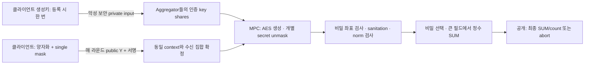

# 일반 PRG + seed MPC: single-mask 비공개 검사와 정확한 집계

작성일: 2026-10-10  
작업 브랜치: `work/aion-private-bound-no-wrap`  
현재 상태(2026-10-11): 실제 4party Rep4·등록 handle binding·영속 public ledger·결과 인증과 공식 Flower 연결을 구현했다. **전체 LeNet5/FMNIST IID 5라운드**에서 최종 정확도 86.24%, 정상 제외 0/20회, 독립 재학습과 정수 SUM·모델 일치를 확인했다. [실제 학습 결과](reproduction/seed-mpc-lenet5-iid-5r-2026-10-11.md). 안전한 secret share disk persistence, 전체 BFT liveness와 전체 구성의 보안 증명은 미완료다. 본문 §1–15의 소수 필드 설명은 설계 기준선이며 현재 native 구현은 §16 이후의 64비트 Rep4 링을 사용한다.

**현재 계약의 통합 문서:** [고정 Committee·Single-mask Seed-MPC 프로토콜](aion-seed-mpc-current-protocol.md). Committee 변경을 범위에서 제외하고, 입력·참여집합의 동시 확정과 client dropout/복귀 설계를 구현 상태와 구분해 정리했다. 이 문서는 설계 변천과 이전 구현 기록을 보존한다.

추가 검증: [Rep4 + 비트 회로 검토](reproduction/rep4-candidate-review-2026-10-11.md). 본문의 소수 필드 방식은 기존 기준선이며, §16에 64bit 링 후보와 등록 방식의 변경을 정리했다.

후속 구현: [runtime 입력·chunk 회로와 컴파일 재사용](reproduction/rep4-chunked-review-2026-10-11.md). 당시 공개 Y를 실행 시 파일에서 읽고 1024좌표까지 검증했다. 이후 signed Flower 업로드와 FIFO로 연결했다. 초기 native 단계는 [첫 구현 기록](reproduction/seed-mpc-native-2026-10-11.md)에 보존한다.

선행연구 검토: [AlphaFL·ELSA·Falkor·ScionFL 비교](seed-mpc-related-work.md). 비공개 norm 검사와 finite-ring overflow 방지는 선행연구에도 있으며, 작은 seed 등록과 MPC 내부 AES의 전체 조합은 별도로 검증해야 한다. 특히 등록 단계의 악성 외부 입력 인증은 backend 선택만으로 충족됐다고 간주하지 않는다.

## 1. 검토 결론과 여섯 조건

**작은 생성키를 공유하고 일반 PRG를 MPC 안에서 실행하면, HPRF 없이 single mask와 비공개 바운더리 검사를 함께 구성할 수 있다.** 마스크 벡터를 매 라운드 VSS로 전송하지 않는다. 합계 키로 마스크를 근사 생성하는 대신 개별 마스크를 비밀 상태로 정확히 생성한다.

이 문서에서는 이전 답변의 `전송 modulus = MPC 필드`를 더 구체화하여 두 공간을 분리한다.

- 전송/마스크 공간: `Z_Q`, `Q=2^w`. 클라이언트가 보내는 값은 고정폭 unsigned word다.
- MPC 계산 공간: 큰 소수 유한체 `F_P`와 악성 보안 binary circuit. 작은 전송 residue를 먼저 비밀 복원하고, 범위가 확인된 정수를 더한다.
- 따라서 **Q는 개별 입력을 유일하게 표현할 만큼 크면 된다. 최종 SUM이 Q 범위를 넘는 것은 허용된다.** 최종 SUM은 Q로 줄이지 않는다.

| 요구 조건 | 제안 방식 | 실제 검증 상태 |
|---|---|---|
| 여러 aggregator의 분산 검사·집계 | 악성 보안 MPC의 계산 참여자로 구성 | 별도 service 4개/native Rep4 실행; 독립 운영자 격리는 미검증 |
| 개별 업데이트 평문 비공개 | key/mask/update/norm/통과 비트를 secret 상태로 유지 | native 경로에서 중간값을 열지 않음; 전체 구성의 증명 미완료 |
| 악성 입력 바운더리 검사 | 복원 residue의 좌표 범위 → sanitation → norm → secret 선택 | 61706좌표 마지막 위반·전체 norm 위반 제외를 oracle와 비교 |
| carry·wrap 없는 정확한 합 | 개별 마스크 exact 제거; 검증한 정수만 넓은 계산 공간에서 합산 | 현재는 64비트 링; 전체 D의 ±80000/±40000 정수 합 확인 |
| 키 share 재사용·효율 | 128-bit 키를 등록 시 공유; 라운드마다 재사용 | native memory에서 등록 1회/3라운드; 안전한 disk share 복구 미완료 |
| single mask | 클라이언트별 AES-CTR 마스크 벡터 하나 | pairwise/private 이중 마스크 없음 |

정확성 대상은 양자화 이후 제출된 정수 업데이트다. 실수 SGD의 양자화 오차는 이 프로토콜의 wrap 오차와 구분한다. Norm 이내 악성 업데이트의 학습 의미를 판별하는 것은 목표 밖이다.



## 2. 참여자·보안 모델·출력 계약

C_i는 악성일 수 있는 학습 클라이언트, P_1..P_N은 MPC를 실행하는 aggregator, Flower coordinator는 공개 모델을 배포하고 최종 결과만 사용하는 서버다. Coordinator를 별도의 신뢰 당사자로 가정하지 않는다.

초기 배치 후보는 N=4, static 악성 aggregator 최대 f=1이다. 합의 계층은 부분 동기 BFT의 N>=3f+1 배치와 2f+1 인증서를 가정한다. MPC는 동일 공격 범위를 견디는 **active/malicious secure** backend를 사용한다. MASCOT의 이론상 dishonest-majority 범위를 BFT·영속 저장·입력 등록까지 자동 확대하지 않는다. 악성 참여자의 abort 가능성은 남는다. 현재 한 장비의 여러 프로세스 실험으로 실제 독립 운영 주체의 공모 보안을 검증한 것은 아니다.

공모 가정은 학습 세션 전체에 대해 static이다. 여러 시점의 share를 수집하는 mobile/adaptive adversary를 허용하려면 proactive refresh와 secure erasure를 추가 설계해야 한다. 입력 범위 검사에는 클라이언트 정직성 가정이 없다.

성공 시 기본 공개값은 `(round_certificate, U, a)`다.

\[
e_i=valid_i\land[\|u_i\|_2^2\le\tau],\quad
U=\sum_i e_i u_i,\quad a=\sum_i e_i.
\]

개별 key/mask/update/norm/e_i 및 합계 마스크는 공개하지 않는다. 정상 output 외의 진단용 per-client 로그도 만들지 않는다. 통과 인원 a와 성공/abort 비트는 허용 누출에 포함한다. 사전에 정한 a_min 미만이면 U와 a를 출력하지 않고 abort 상태만 출력한다. `a_min=2`가 두 honest client를 보장하거나 역추론을 막는다는 뜻은 아니다.

선택 합계가 허용하는 추론은 MPC가 제거하지 않는다. 예를 들어 알려진 입력의 기여를 뺀 결과가 honest input 하나만 남으면 그 값이 드러난다. aggregator-only 공모와 aggregator+client 공동 공모를 구분해야 한다. 후자를 허용할지와 최종 출력의 최소 honest 기여 조건은 별도 threat-model 결정이다. 이 설계의 claim은 우선 **선택 합/인원/abort 이외의 추가 개별 정보를 열지 않는 것**이다. 원래 Aion의 q-2 client 공모 모델과 동일한 전체 프라이버시를 달성했다는 claim은 하지 않는다.

## 3. 기호와 공개 파라미터

| 기호 | 의미 | FMNIST 검토 값 |
|---|---|---|
| D | 좌표 수 | 61706 |
| n_max | 라운드 최대 등록 입력 수 | 4 |
| S | 양자화 scale | 10000 |
| B | 정수 좌표 절댓값 상한 | 20000 |
| tau | 정적 squared-L2 threshold | 25*S²=2500000000 |
| w, Q | 마스크/전송 word 크기와 modulus | w=16, Q=65536 |
| P | MPC 산술 필드 modulus | 후보 2^127-1 |
| k_i | 세션 전용 생성키 | 128 random bits |
| a_min | 공개 결과의 최소 통과 인원 | 초기 2; 프라이버시 보장과 별개 |

필수 조건은 `2B<Q`, `0<=tau<=DB²`, `1<=a_min<=n_max`다. P는 Q뿐 아니라 norm, 선택 합, 비교 프로토콜의 통계 보안 여유를 수용해야 한다.

보수적 비교 폭:

```text
L_wire  = w + 2
L_norm  = bit_length(D*B*B) + 2
L_sum   = bit_length(n_max*B) + 2
L_count = bit_length(n_max) + 2
L       = max(L_wire, L_norm, L_sum, L_count)
```

현재 값은 `L_wire=18`, `L_norm=47`, `L_sum=19`, `L_count=5`, `L=47`이다. Arithmetic comparison은 실제 중간값과 차이가 해당 signed 범위 안에 있다는 전제로 호출한다. Backend가 최소 `L+kappa+2` bit의 field를 요구하는 설정이라면 `kappa=40`에서 89 bit이고, P=2^127-1은 이 후보 조건을 만족한다. 이 산정만으로 특정 MP-SPDZ compile/runtime 설정의 정확성을 인증하지 않는다. 모든 변환과 비교 primitive의 전제를 확인해야 한다.

## 4. 등록: 작은 키만 한 번 공유

### 4.1 기준 경로 — authenticated MPC private input

C_i는 이 프로토콜/세션 전용으로 독립적인 128-bit k_i를 생성한다. 모든 aggregator의 악성 보안 private-input 인터페이스로 키의 bit들을 **등록 시 한 번** 입력한다. 한 aggregator에게 키를 평문 전달하고 그 aggregator가 공유하게 하는 경로는 사용하지 않는다.

등록 MPC는 각 입력 bit가 0 또는 1인지 확인한 뒤 `[k_i]`를 인증된 secret share 상태로 보존한다. Binary 전용 입력 또는 fresh random challenge로 Boolean 관계를 검증하는 방식 중 backend에 맞는 것을 사용한다. Arithmetic field 값에 대해 truncated integer conversion으로 Boolean 검증 결과를 확인하지 않는다. 검증·MAC check를 완료한 뒤에만 key handle을 활성화한다.

공개 등록 record는 `(session, client_id, key_handle, key_version, committee_epoch)`다. 이후 Y_i는 그 key handle에 묶인다. 클라이언트가 라운드마다 다른 키를 주장하거나 coordinator가 다른 key handle로 바꾸지 못한다.

이 경로는 독립된 Aion Feldman-VSS를 그대로 사용하는 것이 아니다. **등록 키의 일관성과 재사용은 authenticated MPC input + 인증 share의 영속 보존으로 구현**한다. 공개적으로 검증 가능한 별도 VSS가 추가 요구사항이라면 아래 경로가 필요하다. 키 share 재사용 조건 자체는 이 기준 경로로 만족시킬 수 있다.

### 4.2 기존 VSS를 유지하는 선택 경로

Aion의 VSS share를 재사용하려면 `VSS-to-authenticated-MPC conversion`이 필요하다. VSS share의 필드·인덱스·threshold·commitment와 입력되는 값을 연결하고, 악성 aggregator가 자신의 입력 share를 바꾸지 못하게 해야 한다. 기존 share를 파일에서 읽어 sint 값으로 선언하는 것은 이 변환이 아니다.

변환은 key를 평문 복원하지 않고, commitment에 결합된 private share input/검증 가능한 resharing으로 authenticated `[k_i]`를 생성해야 한다. 필드가 다르면 범위를 보존하는 conversion도 필요하다. 이 adapter는 아직 구현하거나 선택하지 않았다. 현재 native HPRF fixture의 fresh private key input이 기존 등록 VSS와 연결된다고 표시하지 않는다.

**bit 단위의 공개 Feldman commitment `g^b`는 b=0/1을 바로 드러낸다.** 128개의 key bit에 이를 적용하면 안 된다. Hiding commitment/VSS 또는 안전한 전체-key/limb commitment와 연결된 검증을 사용해야 한다. 이 문서의 기준 경로는 공개 bit commitment를 요구하지 않는다.

### 4.3 키 재사용의 경계

인증 share는 backend의 MAC key와 committee epoch에 연결된다. 같은 secret share 파일을 새로운 독립 MASCOT 실행/MAC key로 그대로 읽어 사용하지 않는다. 지속되는 MPC 세션 또는 검증된 인증 resharing을 사용한다. MPC triple, daBit, 랜덤 마스크 등 소비성 preprocessing은 키처럼 재사용하면 안 된다.

Committee 교체, 저장 상태 분실, 불확실한 rollback에서는 일단 세션을 중단한다. 새 세션에는 새 client key를 등록한다. 무조건 재등록 없이 aggregator dropout을 복구하는 기능은 기준안에 포함하지 않는다.

## 5. 세션·round context와 PRG 정의

입력 전에 다음 값을 모든 aggregator가 동일하게 확정한다.

```text
protocol_version, session_id, committee_epoch,
round_id, actual_global_model_hash, frozen_policy_hash,
ordered_eligible_client_ids, registered_key_handles,
wire_word_bits, dimension, output_policy
```

`actual_global_model_hash`는 클라이언트가 실제 받는 전체 모델을 해시한다. 부분 offset/hash를 전체 모델 바인딩으로 대체하지 않는다. `round_id`는 세션 내 단조 증가하는 64-bit 정수이며, 모델/정책/context에 한 번만 할당한다. context 내용이 바뀌면 새로운 round_id를 사용한다.

128-bit AES counter block을 다음처럼 정의한다.

\[
ctr(r,b)=uint64_{BE}(r)\parallel uint64_{BE}(b).
\]

\[
Z_{i,r,b}=AES128_{k_i}(ctr(r,b)).
\]

AES 출력은 big-endian w-bit word로 나눈다. w=16에서는 block 하나가 8개 좌표 mask를 생성한다. 좌표 j는 block floor(j/8)의 j mod 8 번째 word를 사용한다. 마지막 block의 남는 word는 버린다.

이것은 distinct counter에 대한 AES-CTR keystream 사용이다. ECB로 업데이트를 암호화하는 방법이 아니다. Addition mask로 그 word를 사용한다. 임의의 새 선형 `PRG(k)=k*h`나 보안 근거 없는 단순 생성기는 사용하지 않는다.

각 `(key,round_id,block_index)`는 다른 업데이트에 재사용하지 않는다. 동일 입력의 확정된 결과를 조회하는 것은 허용할 수 있지만 두 번째 새 입력을 같은 address로 받지 않는다. Round context 바인딩은 서명·합의·ledger로 강제한다; 모델 해시를 짧은 랜덤 nonce로 축소하는 데 기대지 않는다. 키는 다른 프로토콜/세션의 AES 작업에 공유하지 않는다.

Counter가 서로 다르다고 출력이 항상 서로 다를 필요는 없다. Mask word 충돌은 정상적이며 nonce/counter 재사용과 다른 문제다. AES stream의 PRG 보안은 전체 block 수에 따른 PRP/PRF 구별 한계를 포함한다. 세션 lifetime·키 rotation 한도는 구현 시 명시한다.

## 6. 클라이언트의 라운드 메시지

클라이언트는 인증한 실제 글로벌 모델에서 local update를 계산하고 다음을 생성한다.

\[
u_{i,j}=RoundEven(S\Delta_{i,j}),\qquad
m_{i,j}=word_j(PRG(k_i,r)),\qquad
Y_{i,j}=(u_{i,j}+m_{i,j})\bmod Q.
\]

정상 클라이언트는 양자화 이후 `|u_i,j|<=B`와 squared norm<=tau를 확인한다. 자동 clipping은 현재 기본안에 포함하지 않는다. 필요 시 별도 정상 입력 생성 정책으로 정의한다. 로컬 확인은 편의이며 aggregator의 검사를 대체하지 않는다.

메시지는 `(context_hash, client_id, key_handle, Y_bytes, signature)`다. Y_bytes는 정확히 D개의 unsigned w-bit word다. w=16일 때 길이는 2D bytes다. Coordinator/공개 저장소로 한 번 전송하고 모든 aggregator가 동일한 signed bytes/hash를 확정하도록 배포할 수 있다.

키, 개별 mask, 개별 norm, 업데이트 평문 및 큰 mask share를 라운드 메시지에 넣지 않는다. 클라이언트끼리 pairwise seed를 만들지 않는다. ZKP도 기준안에는 없다. **모든 바운더리 검사는 aggregator들의 MPC가 수행한다.**

큰 public Y의 배포 비용은 없어지지 않는다. N개 aggregator가 각각 읽으면 그 fan-out traffic이 발생한다. 사라지는 것은 매 라운드 N곳에 추가 secret vector share를 배포하는 비용이다.

## 7. 수신 확정과 MPC public input 바인딩

Aggregator는 context, 등록 key handle, 서명, 차원, canonical word, 중복 client_id를 확인한다. Missing/malformed 메시지는 합의된 deterministic 정책으로 제외한다. Norm 초과 여부는 여기서 평문 판정하지 않는다.

수신 집합 R과 각 입력의 정확한 hash를 consensus로 동결한다. 공격자가 같은 client input을 두 번 더하거나 서로 다른 Y를 aggregator마다 제공하지 못하게 한다. 이 집합은 **secret norm 검사 전 수신 집합**이다. 이전 Aion의 공개 통과 명단 BFT를 그대로 실행하면 e_i를 공개하므로 기준안과 다르다.

Signed public Y를 MPC public-input tape에 넣을 때도 transcript hash 일치를 확인해야 한다. 한 coordinator가 제공한 tape를 무조건 신뢰하지 않는다. Key handle -> 실제 인증 share의 매핑도 context에 결합한다.

수신 중 offline client는 R에서 제외한다. MPC 시작 후 aggregator dropout은 현재 backend 정책에 따라 abort한다. 접수 기한 뒤 새 입력을 처리하려면 새 round/context와 정해진 stale-update 정책을 사용한다. 동일 입력의 부분집합 합을 추가로 공개하지 않는다.

## 8. MPC 내부의 정확한 마스크 제거

MPC는 `[k_i]`로 같은 AES를 실행한다. AES output bit/word는 비밀 상태이며, 악성 보안 binary-to-arithmetic conversion으로 `[m_i,j]`를 만든다. 따라서 mask는 **계산 결과로** `0<=m<Q`를 만족한다. 클라이언트의 주장에 의존하지 않는다.

각 canonical public Y와 secret mask에 대해 다음을 계산한다.

\[
[z]=Y-[m],\quad -(Q-1)\le z\le Q-1.
\]

\[
[b]=[z<0],\qquad [r]=[z]+Q[b].
\]

그러면 `0<=r<Q`이고 `r=(Y-m) mod Q`다. 이 단계의 비교 폭은 B가 아니라 **Q 기준 L_wire**를 사용한다. Mask를 full F_P 원소로 생성하지 않으므로 `Y-m`가 full-field 임의값이라는 문제를 피한다.

이어 두 범위를 검사한다.

\[
[pos]=[r\le B],\qquad [neg]=[r\ge Q-B],\qquad [c]=[pos]+[neg].
\]

`2B<Q`이므로 pos와 neg는 동시에 참일 수 없다. c는 0/1이다.

\[
[v]=[r]-Q[neg],\qquad [u^{safe}]=[c][v].
\]

정상 범위 residue는 정확한 signed u로 복원된다. 중간 residue는 c=0이고 safe 값은 0이다. **원래 범위 위반 bit c는 버리지 않는다.** 클라이언트 전체 유효성에 반영하므로 위반 좌표를 0으로 바꾼 뒤 정상 입력처럼 통과시키지 않는다.

## 9. MPC 바운더리 검사와 선택 집계

\[
[valid_i]=\prod_j[c_{i,j}],\qquad
[q_i]=\sum_j([u^{safe}_{i,j}])^2.
\]

Sanitation을 먼저 했으므로 **악성 Y에 대해서도** `0<=q_i<=DB²`다. Norm 제곱 전에 safe 값을 더 작은 integer width로 잘라 쓰지 않는다.

\[
[e_i]=[valid_i]\,[q_i\le\tau].
\]

\[
[a]=\sum_i[e_i],\qquad
[U_j]=\sum_i[e_i][u^{safe}_{i,j}].
\]

좌표 하나라도 위반하면 해당 클라이언트의 모든 좌표 기여가 0이다. Norm을 넘으면 동일하게 전체 제외한다. 클라이언트가 mask를 틀리게 만들었더라도 제출 Y가 등록 키로 정의하는 effective update를 검사한다. 프로토콜은 클라이언트가 별도로 주장한 로컬 SGD 결과가 진짜라고 믿지 않는다.

비밀 분기에 따라 클라이언트별 통신/루프 길이를 바꾸지 않는다. 모든 R의 D개 좌표를 동일하게 처리한다. c,q,e 및 개인별 오류 종류를 open/log하지 않는다. Transcript 길이는 공개 R,D와 회로 설정에만 의존해야 한다.

`ok=[a>=a_min]`를 계산하고 모든 MAC/check가 완료된 후 결과를 공개한다. Abort 시 U/count를 0으로 마스킹해 내보내더라도 0은 placeholder이며 실제 aggregate로 해석하지 않는다. 최종 signed U는 큰 F_P의 canonical residue에서 확인된 `[-n_max B,n_max B]` 구간으로 해석한다. uint16 binary output으로 좁혀 쓰지 않는다.

Coordinator는 성공 시 `delta=U/(S*a)`를 적용한다. Integer U를 먼저 정확히 수신한 뒤 평균을 float로 변환한다. 평균의 부동소수점 반올림을 SUM wrap와 혼동하지 않는다.

## 10. carry와 wrap가 값에 영향을 주지 않는 이유

### 10.1 Mask carry는 잔여 연산으로 정확히 제거된다

각 Y는 정의상 `u+m=cQ+Y`를 만족한다. 따라서 `(Y-m) mod Q=u mod Q`다. 등록 키와 circuit이 동일한 mask를 정확히 생성하므로 rounding residual E가 없다. `d=21`, HPRF aggregate key, aggregate mask 근사, signed HPRF 복원은 사용하지 않는다.

`|u|<=B<Q/2`이므로 그 residue의 유효 signed 대표값은 유일하다. 위의 pos/neg 회로가 그것을 정확히 찾는다. 예를 들어 Q=65536,m=65530,u=20이면 Y=14이고, z=-65516,r=20이다. u=-20,m=7이면 Y=65523,r=65516이고 signed 복원은 -20이다.

### 10.2 최종 합은 wire modulus로 줄이지 않는다

개별 u를 복원한 뒤 큰 MPC field에서 합산한다. 따라서 Q>2B이면 충분하고 **Q>2n_max B는 필요하지 않다.** 이전 답변의 같은-modulus 방식보다 이 조건을 줄인 것이다.

현재 4명의 각 좌표가 20000이면 U=80000이다. Q=65536의 masked SUM을 직접 centered decoding하면 14464가 되어 틀린다. 이 프로토콜은 개별 복원 후 합산하므로 80000을 출력한다.

### 10.3 Backend wrap는 별도의 범위 증명으로 배제한다

비교 전 difference는 Q 기준 범위가 있다. 좌표 safe 값은 B, 제곱은 B², norm은 DB², 최종 합은 n_max B 기준으로 제한된다. 충분한 F_P와 comparison margin을 선택하면 이 값들의 의미가 alias되지 않는다. 각 share가 모듈러 연산을 하는 것은 정상이다; 원하는 정수 norm/SUM이 다른 값으로 alias되는 것을 배제한다.

Tau는 허용 norm 경계이며 backend norm 용량은 DB² 기준이다. 예를 들어 (10,1)의 제곱합 101을 P=101에서 계산하면 0이 되어 작은 threshold를 잘못 통과할 수 있다. 큰 wire Q만으로 이 문제는 해결되지 않는다.

### 10.4 악성 클라이언트가 주장하는 무제한 원시 정수는 복원할 수 없다

Wire는 residue만 담는다. 악성 클라이언트가 원래 값은 `65536+7`이었다고 주장해도 Y와 key가 정의하는 effective input은 7이다. 이 둘을 wire만으로 구분할 수 없다.

이것을 감추고 모든 원시 정수를 복원한다고 주장하지 않는다. 입력 계약은 canonical bounded quantized integer이고 MPC는 그 effective input만 검사·집계한다. Alias된 큰 원시 값이 SUM에 큰 영향으로 들어가는 것은 아니다. 무제한 원시 업데이트가 실제 SGD와 동일하다는 증명을 요구한다면 별도 ZKP/학습 검증이 필요하다. 정상 client encoder는 범위 밖 입력을 전송 전에 거부한다.

## 11. 프라이버시와 입력 검증의 근거·한계

설계의 구성 논리는 다음과 같다. 정상 client가 독립 random key로 distinct counter를 사용하고 AES stream이 PRG로 안전하면, public Y는 계산적으로 pseudorandom mask에 의해 가려진다. 악성 보안 MPC는 등록 키, 개별 마스크 및 계산 중간값을 공개하지 않고 정해진 출력 함수만 평가한다. 이 두 성질을 합성해 검토한다. 합성 보안 증명과 구현 side-channel 검증은 아직 수행하지 않았다.

16-bit mask word가 곧 16-bit key/security라는 뜻은 아니다. 이상적인 각 좌표의 uniform pad는 16-bit 전체 공간을 가리고, 전체 stream의 계산적 보안은 AES key와 counter 사용 및 호출 수에 의존한다. 범위를 줄인 작은 positive mask나 `Y=u+{0,1}` 같은 공개 표현을 쓰는 것이 아니다.

여러 aggregator가 k_i 자체를 재구성하거나 각자 AES를 평문 계산하는 구현은 금지한다. MPC 내부 `[u]`가 존재해도 각 aggregator가 u를 알게 되는 것은 아니다. MPC가 성공한 뒤에만 coordinator가 최종 SUM/count를 받는다.

Nonce/counter 재사용 시 `Y'_i-Y_i = u'_i-u_i mod Q`가 공개된다. Durable ledger와 키 세션 경계는 이 누출을 막기 위한 기능이다. 입력 확정 후 threshold/cohort를 바꿔 같은 업데이트를 다시 평가하는 것도 금지한다. 실패 후 재시도는 최초 확정 context/input의 같은 논리적 실행이거나 새 key/새 update의 새 세션이어야 한다. MAC 실패 후 received pending output을 먼저 적용하지 않는다.

범위 검사는 다음 주장을 한다: **집계에 기여한 effective integer input은 모든 좌표와 norm 조건을 만족한다.** 실제 training data, SGD 계산, norm 이내 악성 입력의 의미에 대한 주장은 하지 않는다.

## 12. 계산·통신 비용과 실용성

현재 D=61706,w=16에서는 client당 Y payload가 `123412 bytes`다. 헤더·서명·Flower framing은 별도다. 등록 key는 16 bytes의 secret이며 실제 private-input share/MAC/검증 전송은 그보다 크다. Mask share 벡터는 매 라운드 전송하지 않는다.

AES block 수는 `ceil(D/8)=7714`/client, 4 client 라운드에 `30856`이다. MPC norm 제곱은 `4D=246824`개다. Binary AES, key schedule, mask-word conversion, 두 종류의 좌표 비교, norm 비교, secret 선택, 인증 checking/preprocessing 비용이 추가된다. 일반 CPU의 AES 속도를 MPC AES 속도로 취급하지 않는다.

Client의 local masking은 일반 AES와 word 덧셈이므로 비교적 단순하다. Aggregator의 계산·내부 통신은 큰 병목이다. Aion처럼 aggregate key 한 번으로 aggregate mask 하나만 생성하는 효율은 유지하지 못한다. 다수 client의 AES 호출을 병렬화하고 key schedule을 reuse하는 최적화는 가능하지만 실제 circuit/backend의 자원량을 측정해야 한다.

개별 update 직접 공유형과 비교하면 매 라운드 private input vector 전송은 줄지만, 추가 MPC AES가 생긴다. 따라서 이 후보가 전체 시스템에서 더 빠르다고 단정하지 않는다. 현 단계 판정은 **필수 조건들을 단순한 cryptographic primitive로 만족시키는 설계 후보; 효율은 미입증**이다.

가중 FedAvg는 현재 무가중 SUM과 별도다. 검증한 공개 정수 weight h_i를 쓰면 sum bound를 `B*sum(h_i)`로 바꾸고 denominator와 intermediate product 용량도 확인해야 한다. 클라이언트가 주장하는 무제한 weight를 그대로 곱하지 않는다.

## 13. 현재 검증과 재현

2026-10-11: 별도의 [native 구현 검증](reproduction/seed-mpc-native-2026-10-11.md)을 추가했다. 실제 secret-key AES, 최초 seed 입력 한 번과 3round share 재사용, 16-bit wire에서 80000/-40000 SUM 복원, norm/좌표 제외 및 invalid seed 중단을 확인했다. 확정된 synthetic public input을 쓰는 작은 회로이며 제품 등록·BFT·Flower·공동 공모 검증 완료와 구분한다.

합성 oracle: [experiments/audit_seed_mpc_protocol.py](../experiments/audit_seed_mpc_protocol.py). 결과: [seed-mpc-protocol-review-2026-10-10.json](reproduction/seed-mpc-protocol-review-2026-10-10.json).

```bash
cd /home/hacho/@WSL-Projects/trustlessFL
.venv/bin/python -m experiments.audit_seed_mpc_protocol
```

확인한 내용:

- NIST AES known-answer vector 및 정해진 big-endian framing.
- w=2..6의 작은 전체 wire/mask 공간에서 21712개 좌표 범위·signed 복원 검사.
- w=16/32, 4 client, 9 coordinates의 실제 AES synthetic round 300개에서 독립 정수 oracle와 판정·SUM 일치.
- 정확한 norm 경계 `(3,4)` 통과와 `(3,5)` 제외, 범위 위반 client 전체 제외, noncanonical wire 거부.
- U=80000이 Q=65536을 넘는 경우에도 정확한 integer SUM 유지; 잘못된 aggregate-wire decode는 14464.
- counter address 600개 injective framing, 재사용 mask가 업데이트 차이를 드러내는 반례.
- malicious raw integer alias의 effective-input 의미 확인.

Oracle는 key/mask/update를 평문으로 보유하는 공개 합성 검증 도구다. Native AES-MPC 실행, 등록 key의 영속 재사용, 공격 aggregator 주입, BFT, private Flower 학습, 전체 조합 보안 증명을 수행한 것이 아니다. 기존 FMNIST 평문 학습 결과나 HPRF toy MPC 결과를 이 새 구조의 실험 결과로 인용하지 않는다.

## 14. 구현 순서와 완료 조건

1. Backend와 악성 보안 binary/arithmetic conversion을 고정하고 AES known-answer를 **secret key**로 실행한다. Demo의 semi-honest runner를 그대로 채택하지 않는다.
2. 등록 key input/Boolean 검증/인증 영속 저장을 만든다. 두 round에서 키 재전송 없이 같은 key handle로 계산되는지 확인한다. MAC key와 epoch 경계를 검증한다.
3. D가 작은 회로에 이 문서의 signed recovery·range·sanitation·norm·secret aggregation을 연결한다. ±B, ±(B+1), tau 경계, mask carry, U>Q, 악성 제출 형식, invalid key bit를 시험한다.
4. MAC/check 실패·불일치 public input에서 output 적용을 차단한다. 개인별 값/log/open이 없는지 점검한다. Active aggregator fault를 주입한다.
5. Context/receipt consensus와 durable single-evaluation ledger를 연결한다. Receipt set은 공개, norm acceptance set은 비공개로 유지한다.
6. Block당 AES gate/preprocessing/internal traffic와 norm/변환 비용을 측정한다. 작은 수치로 full FMNIST runtime을 단순 외삽하지 않는다.
7. 비용이 감당 가능하면 Flower의 공개 masked payload와 private MPC 결과 경로를 연결하고 quantized reference SUM과 비교한다.

상기 연결 전에는 연구용 설계/산술 reference로 표시한다. Flower Hub 계정·publisher·배포 설정은 이 작업 범위에서 변경하지 않는다.

## 15. 근거 자료

- [NIST SP 800-38A](https://csrc.nist.gov/pubs/sp/800/38/a/final): counter mode와 counter block 사용 원칙. 이 프로토콜의 additive masking·MPC 합성은 별도 설계다.
- [MP-SPDZ mixed circuits와 AES circuit](https://mp-spdz.readthedocs.io/en/latest/readme.html): binary/arithmetic 변환과 AES circuit 지원. 공식 AES demo의 semi-honest 실행은 현재 threat model과 다르다.
- [MP-SPDZ private input 및 persistence](https://mp-spdz.readthedocs.io/en/latest/io.html): client input과 backend별 share/MAC 저장 형식. 기존 VSS share의 안전한 인증 변환을 자동 제공한다는 뜻은 아니다.
- [MP-SPDZ non-linear computation](https://mp-spdz.readthedocs.io/en/latest/non-linear.html): 비교·bit decomposition이 요구하는 값 범위와 보안 여유.
- [MASCOT 원문](https://eprint.iacr.org/2016/505.pdf): malicious-secure arithmetic MPC의 backend 근거. 새 whole-protocol의 증명은 아니다.

## 16. Rep4 + 비트 좌표 회로 후보 (2026-10-11)

현재 N=4, static f<=1 계약을 활용하는 후보로 Rep4를 구현했다. 본문의 소수 필드 계산 공간을 이 후보에서는 `Z_(2^64)`로 대체하며, 악성 aggregator에 의한 중단은 허용한다. Bare MASCOT 계산 엔진과 공모 허용 범위가 동일하다는 뜻은 아니다. 새 backend의 선택으로 입력 확정/BFT/ledger 요구가 없어지지 않는다.

키는 등록 시 두 개의 full-width 64bit word로 입력한다. 전체 128bit entropy를 보존하며 모든 word 값이 유효하다. 외부 등록에서는 Rep4 triple의 세 replicated components를 전달하고, 각 global component의 세 사본 일치와 복원된 곱 관계를 검사한다. 클라이언트의 blinded 응답은 MPC 안에서 네 aggregator의 값이 동일한지 전체 폭으로 검사한다. 소수 필드용 무작위 Boolean 검사와 ExternalIO triple 검사를 링에 그대로 적용하지 않는다. 선택적 128개 비트 입력 경로는 상위 비트가 모두 0인지 full-width 검사한다. 제품 identity 바인딩과 악성 외부 입력의 전체 합성 증명은 남아 있다.

AES의 비밀 w-bit 마스크로 `r=(y-m) mod 2^w`를 비트 회로에서 계산한다. MSB를 부호로 해석하고 `-B<=x<=B`를 비밀 검사한 뒤 invalid 좌표의 비트를 0으로 만든다. unsigned 산술 변환 후 `2^w*sign`을 명시적으로 빼 signed 정수로 옮긴다. 전체 좌표 유효성, norm 및 비밀 선택은 기존 함수와 같으며 SUM은 전송 modulus Q로 줄이지 않는다.

`2B<Q`가 개별 canonical 입력의 유일한 복원을 보장한다. 내부 링은 norm 최대 DB², threshold, 좌표 SUM 최대 nB 및 비교 폭을 수용해야 한다. D=61706, B=20000, n=4에서 DB²=24682400000000<2^45, nB=80000이므로 현재 64bit 응용 산술 상한을 만족한다. 부족한 링/비교 폭은 정책 validator가 거부한다. Wire carry는 발생할 수 있지만 정확한 모듈러 마스크 제거로 값이 달라지지 않는다. 잘못된 내부 정수 폭까지 자동 해결하는 것은 아니다.

최종 값은 native MPC 안에서 공개하며 시험 도구는 네 process의 정상 종료와 결과 일치를 기다린다. 제품은 결과 인증서가 완성되기 전에 이를 모델에 적용하면 안 된다. 2좌표·4클라이언트·3라운드 내부 통신 0.350628 MB와 signed/norm 경계, 악성 등록 중단을 확인했다. 64좌표 fixture도 통과했지만 현재 compile 전개 방식의 확장이 필요하다. 전체 Flower FMNIST, 안전한 영속 키 저장, 독립 운영자 및 실제 악성 native party 시험은 미완료다.

## 17. 실행 시 입력과 chunk 반복 구현

`seed_mpc_chunked_session.mpc`는 정책과 차원, chunk 크기 및 라운드 슬롯 수를 compile 시 정하고, Y와 round counter의 값은 실행 시 읽는다. 기본 AES 병렬도는 4block이며 16bit에서 chunk당 32좌표다. 반복문은 runtime loop이므로 D에 비례해 AES 회로를 Python으로 펼치지 않는다. 같은 계약의 bytecode/schedule을 다른 입력에 재사용할 수 있다. 회로·설정·compiled artifact hash를 확인하고 불일치한 재사용 요청은 거부한다.

각 party의 공개 입력 사본을 MPC에 넣고 전체 64bit equality를 검사한 뒤 사용한다. canonical wire와 마지막 0 padding을 확인한다. 이 equality는 client의 서명과 model/policy/context 인증을 대신하지 않는다. 현재 파일 경로는 synthetic 시험용이다.

각 chunk의 안전한 좌표를 secret memory에 저장하며 유효성 AND와 norm 합계를 누적한다. 전체 chunk가 끝나면 `e_i=valid_i AND [global_norm_i<=tau]`를 한 번 계산하고 모든 좌표에 적용한다. 판정 전에 개인값이나 chunk SUM을 열지 않는다. 여러 chunk 각각의 norm이 threshold 아래여도 전체 합이 넘으면 제외하는 native 반례를 확인했다.

같은 세션에서는 round counter가 양수이며 이전보다 커야 한다. 현재 runtime counter 범위는 1..2^63-1이며 AES counter의 상위 64bit에 배치한다. 프로세스 재시작을 넘는 replay 방지는 ledger 단계에 남아 있다. 상태를 복구하지 못하면 새 키/세션을 사용해야 한다.

64좌표 compile 6.727초, 1024좌표 compile 6.409초를 확인했다. 1024좌표의 3라운드 내부 통신은 43.2678 MB, native 시간 관측값은 17.614초다. 전체 모델의 메모리·WAN 성능·Flower 학습은 아직 검증하지 않았다. 실제 input/context 확정과 사후 결과 인증, 외부 등록의 완전한 합성 검토를 완료 조건으로 유지한다.

## 18. 입력·결과 인증과 영속 라운드 상태

2026-10-11에 고정 4party의 안전성 경로를 native Rep4 세션에 연결했다. 서명된 등록 descriptor의 hash를 실제 private-seed socket에서 확인하고, 등록된 identity/handle과 session·policy·execution 계약을 묶는다. 클라이언트의 signed masked chunk를 전체 좌표의 canonical snapshot으로 고정한다. Norm 통과 명단은 이 snapshot이나 ledger에 넣지 않는다.

정직 aggregator는 입력 snapshot lock을 SQLite에 commit한 후 투표한다. 3개의 입력 서명을 검증하고 `running` 예약을 commit한 뒤 MPC의 FIFO에 round·snapshot hash·wire를 전달한다. 모든 사본의 full-width 일치, signed 복원, 전체 norm, 비밀 선택 및 넓은 SUM 계산은 MPC 안에서 수행한다. Native 공개 결과를 pending으로 보관하고 `check_point()` 뒤 자신의 로컬 process가 출력한 round와 snapshot hash를 확인한 후 결과 투표를 commit·서명한다. 원격 로그나 peer의 완료 주장을 받는 API가 아니다.

동일 결과 body의 서로 다른 aggregator 3개 서명으로 결과 인증서를 만든다. Coordinator와 aggregator는 계약·입력·parent·현재/다음 모델 hash를 검증하고 결정과 모델을 원자적으로 적용한다. Parent는 인증서 전체가 아니라 body hash이므로 3/4서명 인증서 차이로 체인이 갈리지 않는다. 동일 인증서 재전송과 coordinator 재시작 후 재전송은 모델을 다시 갱신하지 않는다. Abort는 결정만 전진시키고 모델은 유지한다.

`running` 상태에서 중단되면 실행을 소비한 것으로 보고 재예약을 거부한다. 공개 ledger가 유실되거나 계약이 다르면 새 session이 필요하다. 정직 디스크의 rollback 방지는 운영 가정이며 안전한 비밀 share 복구는 구현하지 않았다. 첫 입력을 잠그는 구조에는 view change/pacemaker가 없고, native party의 중단으로 학습이 멈출 수 있다. N=4, static f<=1과 허용된 SUM/count의 추론 가능성은 그대로다.

2좌표·65좌표의 실제 3라운드, 최초 키 입력 1회, 등록/입력 변조 중단, 모델 중복 적용 방지를 검증했다. 65좌표 내부 통신은 4.18145 MB였다. Carry/wrap 산술은 §16–17과 동일하며 Q보다 큰 80000, 음수 -40000을 정확히 인증했다. 전체 Flower 모델은 아직 실행하지 않았다. [상세 구현·재현·보안 한계](reproduction/seed-mpc-certified-review-2026-10-11.md).

## 19. Flower masked 전달과 client의 모델 인증

공식 `flwr run`으로 새 ClientApp/ServerApp과 네 별도 aggregator service를 연결했다. Client가 로컬 seed로 single mask를 만들고 signed Y만 Flower에 반환한다. Seed는 최초 한 번 private native 입력 채널로 등록하고 이후 shares를 native 메모리에 유지한다. Coordinator가 raw delta나 seed를 전달받는 API는 없다.

Client도 pinned 계약과 영속 모델 head를 유지한다. 학습 전에 모델 dtype·차원·hash와 다음 round를 검증한다. 학습 context를 디스크에 예약하여 같은 counter의 재요청에는 동일 캐시 ciphertext만 반환하고 불확실한 재시작은 거부한다. 결과 commit에서는 요청 모델을 먼저 검사한 뒤 입력/결과 quorum·parent·next-model hash를 검증하고 한 번만 적용한다.

65좌표/3라운드의 80000·-40000·abort와 170파라미터 FMNIST/3라운드를 실제 Flower·Rep4로 검증했다. 정수 SUM과 모델이 순차 reference와 정확히 일치했고, 잘못된 모델은 학습 전에 거부했다. 작은 FMNIST 내부 통신은 8.34355 MB였다. 이는 전체 61706파라미터 LeNet5 결과가 아니다.

현재 같은 WSL UID의 기능 검증이다. 실제 독립 운영자 격리, 등록부터 결과 공개까지의 공동 공모 합성 증명, BFT liveness, 안전한 share 복구와 dropout 처리의 미완료 상태는 그대로다. Test-only client-local raw audit은 coordinator/API로 보내거나 공개 archive에 포함하지 않는다. [상세 역할·비용·재현·보안 한계](reproduction/seed-mpc-flower-review-2026-10-11.md).

## 20. 전체 차원과 묶음 출력 검증

공식 Flower·Rep4에서 61706좌표의 dense 고정 입력을 3라운드 실행했다. Q=65536, B=20000, S=10000, T=2500000000과 64비트 링을 사용한다. 첫/마지막 합 ±80000, 두 정상 client의 합 ∓40000, 마지막 좌표 범위 위반과 전체 norm 위반의 client 제외, 최소 인원 미달 abort에서 정수 결과와 모든 모델 좌표가 reference와 정확히 일치했다. Abort는 결정 head만 전진하고 모델은 유지했다.

최종 합계 계산/opening은 32좌표 벡터로 묶는다. 모든 client의 전체 norm과 선택 비트가 먼저 완성되며, 비밀 `ok*accepted_i`를 각 청크 전체에 적용한다. 합계를 Q로 다시 줄이지 않는다. 마지막 10좌표 뒤의 padding 22개는 내부에서 0으로 정리하고 결과 좌표로 출력하지 않는다. Client별 norm/선택/update와 mask는 열지 않는다.

Compile은 6.870초에 한 번, 각 client seed 입력도 세션 초기에 한 번이었다. 3라운드 ServerApp 시간 733.502초, native 통신 2476.15MB, native 프로세스 최대 RSS 145.82MiB였다. 관련 Python 202개와 변경 후 native 회귀 9개가 통과했다. [전체 차원 비용·오류 입력·보안 범위](reproduction/seed-mpc-scale-review-2026-10-11.md). 이 결과는 LeNet5 크기의 프로토콜 입력 시험이며 실제 LeNet5 학습 정확도 결과가 아니다. Static f<=1, 전체 BFT/구성 증명 미완료 등의 제한은 그대로다.

## 21. 실제 전체 LeNet5 학습

같은 single-mask/seed-MPC 경로로 공식 Flower의 FMNIST IID 1라운드를 완료했다. 전체 학습 60000장/client 4명, 테스트 10000장, LeNet5 61706파라미터를 CPU에서 학습했다. 초기 seed 42, 로컬 1 epoch/batch 64, SGD lr 0.01/momentum 0.9/weight decay 0.0005다. Client별 235 step이며 공개 모델을 float32 파라미터로 로드한 직후와 학습 후의 차이를 양자화했다.

정적 S=10000/B=20000/T=2500000000/Q=65536 정책을 유지했다. 4/4 client가 통과했고, 기존 `FmnistTrainer`로 별도 재학습한 정수 업데이트·SUM/count·최종 모델이 정확히 일치했다. 테스트 정확도는 10.00%에서 74.84%, loss는 2.307323에서 0.679621로 바뀌었다. ServerApp counter 256.587초, native 통신 825.968MB, native process 최대 RSS 71.52MiB, compile 6.300초/1회였다. Native 사후 CHECK와 인증 모델의 중복 적용 거부도 확인했다.

관련 Python 204개가 통과했다. [실제 학습·비용·공개 재현 기록](reproduction/seed-mpc-lenet5-learning-2026-10-11.md). 정상 학습의 단일 라운드이며 multi-round 정확도 곡선·전체 구성 보안 증명·독립 운영자 격리 결과를 대신하지 않는다. §20의 wrap/위반 입력 회귀와 static f<=1 계약, 공개 SUM/count의 추론 및 share 복구/BFT liveness 미완료 상태는 유지된다.

## 22. 실제 IID 5라운드와 seed 재사용

§21과 같은 초기 LeNet5·전체 데이터·CPU SGD·정적 정책으로 새 세션의 1~5라운드를 실행했다. 정확도는 74.84%→80.54%→83.72%→84.99%→86.24%였고 모든 라운드에서 4명 모두 통과했다. 20회 클라이언트 학습의 양자화 업데이트, 5개 native 정수 SUM/count와 공개 모델이 기존 `FmnistTrainer`의 독립 재학습과 모든 좌표에서 정확히 일치했다. 초기 및 1라운드 모델은 이전 실행과도 정확히 같았다.

Compile과 client별 seed 등록은 세션 전체에서 각각 1회다. 모든 native 사후 CHECK와 client 인증 모델 head, 중복 commit 거부를 확인했다. ServerApp counter 1253.902초, native 통신 4126.98MB, native 최대 RSS 204.61MiB였다. [전체 결과·비용·학습된 모델](reproduction/seed-mpc-lenet5-iid-5r-2026-10-11.md).

이 결과는 정상 IID 5라운드 기능·정확성 검증이다. Static f<=1, 같은 WSL/UID, 허용된 SUM/count의 역추론 및 전체 구성 증명·share 복구/dropout·BFT liveness 미완료 상태는 유지된다. Non-IID 실제 MPC 학습은 아직 실행하지 않았다.
