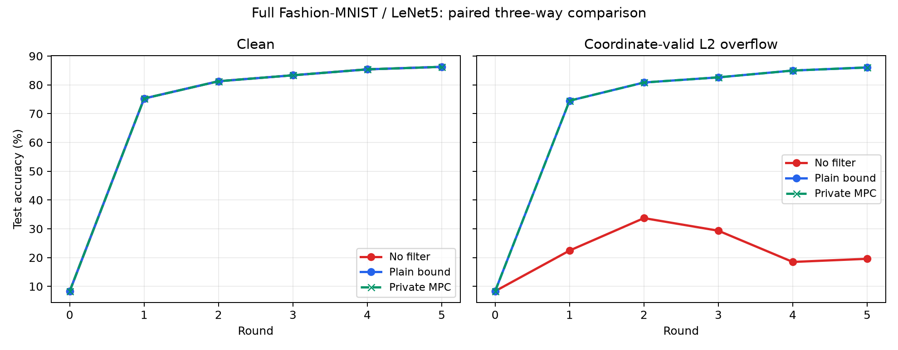

# 졸업작품 발표 구성: 배경·동기·이전 연구·우리 연구·결과 비교

2026-10-17. 발표용 구성안이며 새로운 실험을 실행하지 않았다. 실측은 보존된 결과 JSON과 대조했다.

작품명 예시: **안전한 다자간 계산(MPC) 기반 비공개 업데이트 검증을 지원하는 연합학습 프레임워크**.

핵심 설명: **개별 업데이트를 직접 공개하지 않고 입력 바운더리를 강제하는 시스템을 Flower에 구현하고, 실제 학습에서 평문 검사와의 결과 일치 및 실행 비용을 검증했다.**

## 1. 배경

연합학습은 원본 데이터를 각 클라이언트에 두고 로컬 업데이트로 모델을 공동 학습한다. 그러나 원본 데이터를 전송하지 않는 것만으로 업데이트나 학습 결과에서의 정보 추론까지 방지하지는 않는다. 개별 업데이트를 숨기기 위한 secure aggregation과 입력의 적합성 검사는 별개의 기능이다.

악성 클라이언트는 학습을 방해하는 업데이트를 제출할 수 있다. 평문 업데이트를 보는 서버는 좌표나 norm을 검사할 수 있지만, 개별 입력을 숨기면 같은 검사를 직접 수행하기 어렵다. 따라서 입력 기밀성과 입력 제한을 함께 구현해야 한다.

발표 문장: “업데이트를 숨기면서도, 허용 범위를 넘는 입력은 집계에서 제외할 수 있을까?”

## 2. 동기

우리의 목표는 새로운 poisoning 탐지 기준을 발명하는 것이 아니다. 공개된 정적 좌표·L2 바운더리를 클라이언트의 자체 판단에 의존하지 않고 강제하면서, 개별 업데이트를 서버에 직접 공개하지 않는 실행 경로를 만드는 것이다.

설계 선택은 클라이언트 ZKP 대신 aggregator MPC에 검사 계산을 배치하는 것이다. 클라이언트는 증명 생성 부담을 지지 않지만, 독립 aggregator 운영과 MPC 비용을 요구한다. 클라이언트 비용이 선행연구보다 낮다는 정량 주장은 아직 없다.

### 바운드 선택과 DP를 구분하는 발표 설명

Norm bound는 모델·데이터·학습 설정에 맞춰 운영자가 정하는 정책 파라미터다. 정상 업데이트의 분포와 별도 검증 데이터의 성능을 참고해 선택할 수 있지만, 너무 낮으면 정상 입력을 제외하고 너무 높으면 큰 악성 입력을 허용한다. 본 작품은 최적 바운드 자동 선택이나 더 정밀한 poisoning 탐지를 주장하지 않는다. 실험의 L2 반경 5는 해당 평가 조건이며 다른 환경에 보편적으로 적합하다는 뜻이 아니다.

DP도 서버에 대한 프라이버시를 제공할 수 있다. 특히 로컬 DP는 서버가 받는 개별 메시지 자체의 정보 노출을 제한하는 대안이다. 따라서 “DP는 서버로부터 보호하지 못한다”, “DP로는 이 설계가 불가능하다”라고 설명하지 않는다. 분산 DP와 보안 집계를 결합하는 연구도 있다.

우리의 선택은 **추가 DP 노이즈 없이 설정된 정책을 비공개로 집행하고 평문 동일 검사 결과를 재현하는 것**이다. 바운드 검사 자체는 학습 결과에 영향을 주며, DP와 직접 비교한 정확도·비용 우위는 측정하지 않았다. 현재는 DP를 구현하지 않아 공개 SUM/count/abort와 최종 모델에서의 개인 기여 추론에 대한 DP 보장을 제공하지 않는다. DP 결합에는 보호 단위, 프라이버시 예산, 라운드별 누적 손실과 모든 공개 출력의 분석이 추가로 필요하다.

참고: [DP와 보안 집계를 결합한 ICML 2021 연구](https://proceedings.mlr.press/v139/kairouz21a.html), [중앙·분산 DP의 보호 범위 설명](https://research.google/blog/distributed-differential-privacy-for-federated-learning/).

## 3. 이전 연구

관련 연구는 **개인의 기여에 따른 정보 노출을 제한하는 DP**와 **개별 입력을 숨긴 상태로 집계·검증하는 암호 프로토콜**을 함께 소개한다. 서로 다른 보장을 제공하며 결합할 수도 있다. DP를 제외한 채 암호 프로토콜끼리만 비교하면 개인정보 보호 접근에 대한 배경이 불완전하다.

| 연구·접근 | 접근 | 우리와 비교할 지점 |
|---|---|---|
| 로컬 DP | 클라이언트가 입력·업데이트를 무작위화해 서버가 받는 개별 메시지의 정보 노출을 제한 | 서버에 대한 프라이버시 대안. 보호 단위·프라이버시 강도에 맞는 노이즈 설계가 필요하며, 그 자체가 악성 클라이언트의 입력 제한 준수를 검증하지는 않음 |
| 중앙 DP | 신뢰하는 처리 주체가 기여도를 제한하고 집계 등에 노이즈를 넣어 공개 결과를 보호 | 서버가 이미 관찰한 평문 개별 업데이트는 그 관측으로부터 보호하지 않음. 노이즈 추가 전에 무엇을 누가 보는지 구분 |
| 분산 DP + 보안 집계: Kairouz·Liu·Steinke, ICML 2021 | 기기에서 이산 Gaussian 노이즈를 추가하고 보안 집계로 노이즈가 포함된 합만 서버에 공개 | 서버에 대한 보호와 공개 결과의 DP를 결합하는 방향. 클라이언트가 노이즈를 넣는다는 사실만으로 로컬 DP인 것은 아님 |
| ACORN | 단일 서버가 클라이언트의 입력 유효성 ZKP를 검증. Detect와 robust 변형을 구분 | 클라이언트 증명 생성과 서버 검증에 비용을 배치 |
| Aion | 여러 aggregator, HPRF single mask·VSS, masked gradient에 대한 동적 입력 제한 | single mask·서버 측 검사라는 출발점. 현재 구현은 이 구조의 단순 포팅이 아님 |
| Armadillo | 단일 집계 서버와 보조 decryptor 클라이언트, ZKP·비밀 공유, 통과한 입력의 키 합 복구 | 개인 마스크를 열어 악성 기여를 제거하는 경로를 피함. 서버는 honest-but-curious 가정 |
| AlphaFL | 두 서버 MPC에서 좌표·norm 검사와 비공개 선택 집계 | 서버 MPC 검사가 이미 연구됐음을 명시. 우리 방식이 최초라고 주장하지 않음 |
| 우리 구현 | 고정4 aggregator·Rep4, seeded single mask, 정적 좌표/전체 L2, 정확한 signed 복원·wide SUM, Flower 통합 | 작은 seed 등록과 클라이언트 증명 없는 입력 경로를 시스템으로 구현·검증 |

DP는 악성 업데이트 탐지 기법 자체와 동일하지 않다. 우리 구현은 추가 DP 노이즈 없이 설정된 바운드 검사를 비공개로 실행하는 기능을 평가했으며, DP 대비 정확도·비용 우위나 공개 결과의 DP 보장을 주장하지 않는다.

위 표는 구조 비교다. 다른 신뢰 모델·기능을 같은 조건으로 취급하지 않는다. 특히 ACORN-detect는 위반 시 중단할 수 있고, ACORN-robust는 제외 후 진행 기능을 갖지만 semi-honest 서버 보장이다. ACORN 논문은 robust를 직접 벤치마크하지 않았다. Armadillo의 단일 서버도 보조 클라이언트들 없이 혼자 복호화하는 구조가 아니다.

근거: [분산 DP와 보안 집계, ICML 2021](https://proceedings.mlr.press/v139/kairouz21a.html), [중앙·분산 DP 설명](https://research.google/blog/distributed-differential-privacy-for-federated-learning/), [ACORN 공식 소개](https://www.usenix.org/conference/usenixsecurity23/presentation/bell), [ACORN 원문 §2.1·§4.2·§6](https://www.usenix.org/system/files/usenixsecurity23-bell.pdf), [Aion 원문](https://www.usenix.org/system/files/usenixsecurity25-liu-yizhong.pdf), [Armadillo §1.2·§3](https://arxiv.org/html/2511.10863v1), [AlphaFL](https://petsymposium.org/popets/2025/popets-2025-0134.pdf).

## 4. 우리 연구·구현

### 처리 흐름

1. Client가 로컬 학습 후 업데이트를 정수로 양자화한다.
2. 최초 등록한 seed component로 round별 마스크를 생성해 single masked vector를 제출한다.
3. Aggregator들이 완전한 제출과 수신증명을 확보하고 동일한 입력 집합을 확정한다.
4. MPC 내부에서 mod-2^16 마스크 제거·signed 복원, 좌표·global L2 검사를 수행한다.
5. 통과한 업데이트만 넓은 정수 공간에서 합산하고 SUM/count 또는 abort를 공개한다.
6. 인증된 결과로 모델을 갱신하고, 이탈·복귀한 client는 인증 체인을 확인한다.

양자화 정수 입력을 u_i, presence를 p_i, coordinate cap을 B, squared-L2 threshold를 T라 두면:

\[
e_i=p_i\cdot\mathbf1[\forall j,|u_{i,j}|\le B]\cdot\mathbf1[\sum_j u_{i,j}^2\le T],\qquad U=\sum_i e_i u_i,\quad a=\sum_i e_i.
\]

성공 조건 a≥minimum_accepted일 때만 공개 모델을 U/(Sa)로 갱신한다. 조건 미달이면 abort로 모델을 유지한다. 실수 SGD 자체의 진실성을 증명하지 않으며, 검사 대상은 복원된 유효 양자화 정수 입력이다. 현재 집계는 통과한 클라이언트의 동일 가중 평균이며, 데이터 수에 비례하는 가중 FedAvg와 구분한다.

### 설계에서 강조할 내용

- 개별 업데이트·norm·통과 비트를 직접 공개하지 않는 비공개 검사.
- 작은 전송 modulus와 넓은 계산 공간의 분리. Wire wrap이 있어도 canonical 정수를 복원하고, 최종 SUM을 wire modulus로 줄이지 않음.
- 클라이언트 간 pairwise mask 교환 없이 최초 seed 등록과 fresh round 마스크 사용.
- 입력/결과 인증서, 서명, durable lock, 중복 실행·모델 적용 방지.
- 실제 Flower 연결, 사용자 MLP/CNN/LeNet 모델 adapter, dropout·복귀, 역할별 Docker 실행과 설치 패키지.

### 신뢰 모델과 한계

Aggregator는 고정4개이며 세션 전체에서 최대1개 static 악성·공모를 가정한다. 두 aggregator 공모는 개인 마스크 복원을 가능하게 한다. SUM/count/abort·모델에서 가능한 역추론은 허용된 출력 누출에 남는다. 통과2명이 honest2명을 뜻하지 않는다.

현재 native MPC는 네 party 모두 실행돼야 하며, 한 aggregator의 중단을 견디는 BFT liveness를 제공하지 않는다. Norm 내부의 악성 입력은 걸러낸다고 보장하지 않는다. 독립 운영자4명을 확보하는 비용과 서버 간 MPC 통신이 크다. 전체 FL composition 보안·DP를 증명한 시스템은 아니다.

## 5. 결과 비교

### 5.1 학습 효과와 정확성: 실제 측정

조건: Fashion-MNIST train60,000/test10,000, LeNet5 61,706 parameters, client4·aggregator4, IID 각15,000개, seed42/43/44, 조건별5 rounds. Local epoch1/batch64/SGD lr0.01/momentum0.9/weight decay0.0005. S10,000·Q65,536·B20,000·T2,500,000,000(양자화 L2 반경5)·minimum accepted2.

| 조건 | 무필터 양자화 평균 | 평문 동일 bound | 실제 비공개 MPC bound |
|---|---:|---:|---:|
| 정상: 평균 최종 정확도 | 86.24% | 86.24% | 86.24% |
| L2 범위 초과 공격: 평균 최종 정확도 | 19.58% | 86.03% | 86.03% |
| 공격 입력 제외 | 0/15 | 15/15 | 15/15 |
| 정상 입력 제외(정상+공격 조건) | 0/105 | 0/105 | 0/105 |

공격은 C0 한 명의 자체 업데이트를 부호 반전·확대해 norm 약10으로 만들되 모든 좌표를 B 안에 유지한 경우다. 실제 MPC30 rounds·120 client-round 입력을 대조했고, 평문 동일 검사와 정수 SUM/count·모델·평가가 정확히 일치했다. 제외 지표는 trusted 실험 oracle의 지표이며 제품 서버가 개별 norm을 공개받았다는 뜻은 아니다.

해석: norm 초과 공격을 차단한다는 결과와 함께, **프라이버시를 위한 처리를 추가해도 평문 동일 검사의 결과가 달라지지 않았다**는 점을 강조한다. 일반적인 poisoning 탐지 성능이나 최적 threshold를 발견했다는 주장은 아니다. 공격 시 정확도 회복은 동일한 바운드 정책을 평문으로 적용해도 얻어진다. 우리 시스템의 검증 대상은 그 정책을 개별 입력을 직접 공개하지 않고 실행하는 기능과 정확성이다. 이 학습 결과만으로 프라이버시가 증명되는 것은 아니다.

[학습 결과 원문·JSON](reproduction/graduation-three-way-2026-10-12.md).

### 5.2 비용: 실제 측정

공식 Flower에서 새로 학습한 공격 조건3 seeds,5 rounds 평균이다. 컴파일/준비·사후 oracle를 제외한 ServerApp 전체 시간이며 순수 MPC 시간과 다르다.

| 지표 | 평문 동일 bound | 비공개 MPC | 비율 |
|---|---:|---:|---:|
| ServerApp 시간 | 36.44초 | 186.69초 | 5.12배 |
| 추적 payload | 22.28MB | 2,164.74MB | 97.16배 |

Native 네 aggregator 송신량은 라운드 평균 약273.86MB다. 추적 payload는 Flower 논리 object graph·RPC body·native Player counter의 합이며 전체 TCP/TLS wire가 아니다. 전송 계층 header와 미추적 IPC 등을 제외하고 Flower 메시지 간 cache 할인은 하지 않았다.

[비용 보고서](reproduction/flower-cost-improved-2026-10-12.md). 비용은 프라이버시 추가의 오버헤드이며 ACORN/Aion/Armadillo 대비 효율 우위가 아니다. 내부 ACK·동기화 최적화 전후64.0% 시간 감소는 선택적 구현 개선 자료로만 제시한다.

### 5.3 보조 검증과 미완료

- 작은 모델에서4/8/16명 실제 Flower·Rep4 학습, Q보다 큰 signed SUM·dropout·abort 검증 완료.
- 다른 사용자 모델·별도 설치 wheel·Docker 역할 분리·이탈과 새 node ID 복귀 검증 완료.
- 지정한 native share/component/opening 변조 차단 사례와 관련 회귀 검증 보유. 전체 보안 증명을 대신하지 않음.
- **100명 실제 학습은 미완료**. 소형 CNN100명 준비·컴파일 뒤 WSL 중단, 사용자 지시로 정지. 성공 결과로 포함하지 않음.
- 실제4개 독립 물리 호스트/기관 운영·WAN 비용, 최신 최적화 전체 LeNet 재측정, Flower Hub 게시 미완료.
- 주요 학습·비용 수치는2026-10-12 당시 기록된 구현의 결과다. 최근 대규모 준비 최적화가 전부 포함된 최종 release 성능이라고 표현하지 않는다.

전체 현황은 [종합 완료 기록](reproduction/graduation-status-2026-10-14.md)에 있다.

## 발표 마무리 문장

“본 작품은 새로운 norm 탐지 규칙보다 비공개 입력 검사의 실제 구현에 초점을 맞췄습니다. 고정된 여러 aggregator가 MPC로 업데이트를 검사하고, 통과한 입력만 정확히 집계하도록 Flower에 통합했습니다. 실제 FMNIST 학습에서 평문 검사와 동일한 결과를 확인했고, 프라이버시를 위한 시간·통신 오버헤드와 운영 한계도 측정했습니다.”
