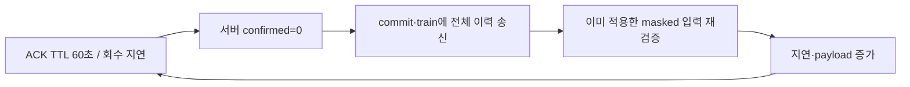

# Flower MPC 비용 증가의 원인 확인

**주요 원인은 ACK 회수 지연으로 인한 전체 인증서 chain 재전송과, 이미 적용한 masked manifest의 반복 검증이다.** 기존 비용 실험에서 MPC 4회 모두 서버의 client confirmed round가 0에 머물렀지만, 클라이언트 SQLite/trace에는 실제 모델 적용이 남아 있다. MPC 회로 실행 시간과 별개로 동기화 경로가 라운드마다 길어졌다.

## 조사 방법

- 이전 비용 실험의 정상 1회 + 공격 3회 결과, 클라이언트 sync trace, 라운드별 timing, 로컬에 설치된 Flower 1.36.0의 TTL 처리 코드를 대조했다.
- 실제 공개 transcript와 이미 decided 상태의 client ledger를 SQLite read-only backup으로 복제해 synchronize를 재실행했다. 원본 모델·ledger·키·seed는 변경하지 않았고 키/seed 파일을 읽지 않았다.
- 학습이나 MPC 5라운드를 다시 돌리지 않았다. 실제 입력으로 동기화 hot path를 분리해 프로파일링했다.

## 1. ACK가 회수되지 않아 confirmed=0 유지

CommitNotifications는 query.commit TTL을 60초로 설정한다. 서버는 정상 전원 참여 경로에서 라운드 시작과 결과 적용 뒤에 ACK를 poll하지만, 긴 수집·입력 인증·MPC 실행 동안 주기적으로 poll하지 않는다.

아래는 seed 42 공격 실행에서 ACK poll 사이에 들어가는 계측 단계 4개의 합이다. 해당 단계는 수집/manifest, input certificate, execute/result certificate, coordinator/committee apply이다. 모든 라운드에 전원이 참여하므로 결원 대기 루프 안의 추가 poll도 실행되지 않았다.

| round | ACK poll 없는 계측 단계 합계(초) | ACK TTL |
|---|---:|---:|
| 1 | 32.816 | 60 |
| 2 | 66.595 | 60 |
| 3 | 96.269 | 60 |
| 4 | 123.707 | 60 |
| 5 | 154.439 | 60 |

2라운드부터 계측 단계 합만으로 60초를 넘는다. Flower는 원 요청의 created_at+ttl이 지나면 이미 생성된 reply가 있어도 요청 expiry를 먼저 확인해 Message Unavailable 오류를 반환할 수 있다. 설치된 공식 함수에서도 59초에는 오류가 없고 61초에는 오류가 생기는 것을 재현했다.

실제 네 실행에서는 C0~C3의 confirmed가 모두 0이고, 회수된 ACK 16건/실행이 모두 missing이었다(합계 64건). 클라이언트는 대부분 round 1~4 commit을 정상 적용했고 다음 train의 applied_decisions는 0이었다. 실행 로그에도 TTL 만료 오류가 있었다.

개별 missing 이벤트가 error code/reason을 저장하지 않았으므로 64건 각각의 오류 종류를 사후에 분류하지는 못한다. TTL 60초·poll 공백·실제 expired 로그·공식 함수 재현을 합쳐 확인한 ACK 회수 문제이며, 다른 transport 오류까지 모두 TTL이라고 단정하지 않는다.

코드: [ACK TTL/confirmed 처리](../../trustlessfl/seed_mpc_dropout.py), [서버 poll/학습 chain 송신](../../trustlessfl/seed_mpc_server_app.py).

## 2. 이미 적용한 전체 이력을 두 경로로 다시 보냄

서버는 records[confirmed[client]:]를 query.commit과 다음 train 요청에 넣는다. confirmed=0이면 매번 1라운드부터 전체 이력을 보낸다. 이 이력에는 작은 인증서만 들어가는 것이 아니라 모든 클라이언트의 masked 입력 manifest와 결과 SUM 등이 포함된다.

- round당 masked manifest: 약 **5.84 MB**.
- 각 manifest의 client 서명 chunk: **7,716개** = client 4명 × ceil(61,706/32).
- 같은 이력을 모든 클라이언트에게 전달하고, commit과 train에서 다시 검증한다.
- 한 worker로 클라이언트를 실행한 비용 실험에서는 pending commit 작업과 다음 train 작업도 같은 worker에서 처리돼 추가 지연이 다음 수집 구간에 포함된다.



## 3. 반복 검증의 실제 비용

저장된 client head를 유지한 채 동일한 기존 결정만 재전송했다. 모든 재생은 applied_decisions=0이며 원본과 복제본 head가 바뀌지 않았다.

| 기존 결정 재전송 수 | synchronize wall 초 | 실제 추가 모델 적용 |
|---:|---:|---:|
| 0 | 0.0459 | 0 |
| 1 | 3.5296 | 0 |
| 2 | 7.2290 | 0 |
| 3 | 10.4203 | 0 |
| 4 | 13.7491 | 0 |

새 학습 없이 기존 결정 4개를 다시 검증하는 것만으로 클라이언트 한 명에 약 13.75초가 들었다. 프로파일링을 켠 별도 실행은 약 26.02초였으며 profiler overhead가 포함돼 위 wall과 혼합하지 않는다.

| 함수 | 호출 수 | 누적 profile 초 |
|---|---:|---:|
| check_manifest | 16 | 23.192 |
| manifest | 16 | 22.431 |
| verify | 123,520 | 8.871 |
| deepcopy | 10,493,200 | 9.669 |
| canonical | 494,138 | 4.249 |

누적 시간은 부모/자식 함수가 겹쳐 합산하면 안 된다. 원인 확인에 사용한다.

- synchronize가 직접 check_manifest를 호출하고 input_body에서도 다시 호출한다.
- 다음 state.apply 루프에서 check_manifest와 input_body가 다시 검증한다.
- 따라서 기존 결정 하나당 manifest 검사 4회, 결정 4개면 16회다. 7,716개 chunk × 16 = **123,456개 client chunk 서명 검증**, 여기에 quorum vote 검증을 합쳐 총 **123,520회**가 관측됐다.
- manifest 재구성의 deep copy도 **10,493,200회**의 재귀 호출을 만들었다. 서명·JSON·복사가 같은 공개 transcript에 반복된다.
- SQLite의 정확한 재적용 방지가 깨진 것이 아니다. trace와 재생에서 모델 추가 적용은 0이었다. 이미 검증한 이력을 계속 보내고 확인하는 비용이 문제다.

## 비용 실험과 연결

- 공격 3-seed 평균에서 client SGD/양자화/공격 시간은 평문 bound 22.78초, MPC 22.92초로 비슷했다.
- 수집/receipt/manifest 구간은 평문 bound 24.60초, MPC 357.79초였다. 위 반복 동기화 경로가 이 구간에 포함된다.
- MPC 실행/결과 인증은 평균 67.46초였다. 전체 518.61초를 MPC 회로 연산만의 비용으로 설명하면 부정확하다.
- Native Player 송신량은 round당 약 273~274 MB로 일정한 반면, 전체 관측 계층 payload는 round 1 약 412 MB에서 round 5 약 634 MB로 커졌다. 이력 재전송과 맞는 증가 패턴이다.
- 기존 비용 수치는 이 동기화 문제를 포함한 실제 현재 구현 비용이다. 최적화 후 비용은 수정 및 재측정 전까지 제시하지 않는다.

## 개선 우선순위

1. ACK를 수집 대기·긴 RPC 실행 중에도 주기적으로 회수하고, 만료된 경우 새 signed head 확인으로 복구한다. ACK를 모든 클라이언트가 보내야 다음 라운드가 시작되는 조건으로 바꾸지는 않는다.
2. 확인된 head 이후의 결정만 보내고, 정상 온라인 클라이언트에는 compact QC/model 정보, 복귀 클라이언트에는 필요한 suffix를 보내는 경로를 설계한다. Full manifest를 제외해도 입력 commitment·session·round·parent·policy/model binding 검증은 보존해야 한다.
3. 이미 검증된 동일 transcript의 검증 결과를 신뢰하는 durable state/immutable cache를 사용해 중복 검사와 복사를 줄인다. 변경된 payload·signature·context는 기존 검증을 거쳐야 한다.
4. 위 경로 수정 후 같은 3-seed Flower 비용 비교와 변조·재전송·dropout/rejoin 회귀를 재실행한다.

이번 요청에서는 원인 확인과 프로파일링만 수행했다. 운영 프로토콜·MPC 회로·검증 규칙은 수정하지 않았다.

## 재현과 자료

```bash
.venv/bin/python -u -m experiments.profile_flower_cost_collection \
  --runs .cache/flower-cost-comparison-2026-10-12-v2 \
  --output .cache/new-collection-diagnosis
```

[호출 수·실제 재생 시간·기존 실행 근거 JSON](flower-cost-bottleneck-2026-10-12/diagnosis.json). 재현 스크립트는 함수/시간 프로파일을 만들며, 추가 TTL 함수 재현과 poll 공백 합산은 공개 JSON에 별도로 기록했다.
