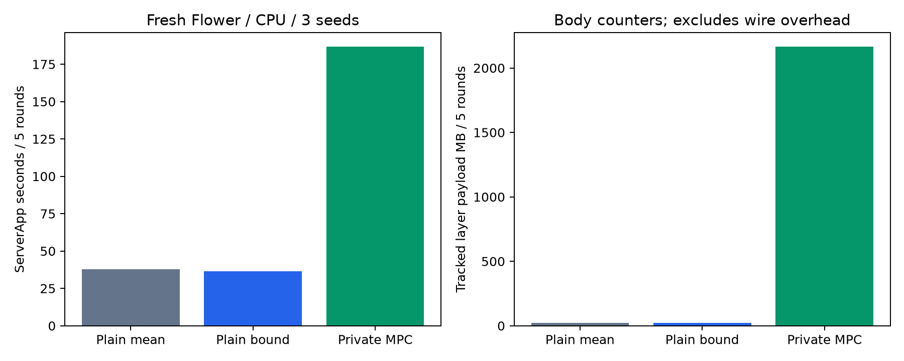

# 같은 Flower 환경의 평문·MPC 비용 비교

**공격 조건의 3-seed 평균에서 평문 bound는 36.44초, 실제 MPC는 186.69초로 5.12배였다. 5라운드 추가 시간은 150.25초다. 두 방식의 정확도는 86.03%로 같았다.**

2026-10-12. 새로 실행한 비용 비교다. 앞선 순차 reference 시간이나 SGD cache 시간을 분모로 사용하지 않는다.

## 비교 조건

- Full FMNIST train 60,000 / test 10,000, LeNet5 61,706개 파라미터, IID client 4명·각 15,000개.
- CPU local epoch 1, batch 64, lr .01 / momentum .9 / weight decay .0005, S=10,000, B=20,000, L2 반경 5, 최소 통과 2.
- 공식 Flower Simulation/Ray, simulation worker 1, 동일 dependency/runtime guard, 각 실행 별도 SuperLink/세션/클라이언트 상태. 동시에 실행하지 않았다.
- 정상 seed 42는 교차 확인 1회/방식, 공격 seed 42·43·44는 3회/방식. 총 **12개 실행·60라운드**, 그중 **실제 MPC 4회·20라운드**.
- 세 방식 모두 각 라운드 현재 모델에서 새로 SGD를 수행한다. 다른 방식·라운드의 학습 결과를 cache로 대체하지 않는다. 프로토콜 재전송용 durable cache는 별도다.
- 공격 C0는 자기 업데이트를 부호 반전/확대하여 L2 약 10으로 만들고 좌표 상한은 지킨다. 이전 효과 실험과 모델/정확도가 정확히 일치하는지 검증했다.
- 평문은 별도 trusted 연구용 앱으로 signed16 업데이트를 서버에 공개한다. 일반 사용자·private MPC 경로를 평문으로 바꾸지 않았다.
- 평문도 모델 commit/ack와 로컬 audit을 수행한다. MPC에는 4-party privacy·악성 검사·마스킹·인증서·수신증명·동기화 비용이 추가된다. 측정 배율은 **전체 구현의 추가 비용**이며 MPC 곱셈 연산만의 배율이 아니다.
- 최초 공통 학습 setup과 회로 준비, 실제 Flower 실행, 사후 독립 재학습 검증 시간을 분리했다. 각 모드의 전체 private 자료는 local .cache에만 있다.

## 시간과 학습 효과

| 조건 | 방식 | 반복 | ServerApp 평균 초 ± SD | Flower CLI 평균 초 | 최종 정확도 평균 |
|---|---|---:|---|---:|---:|
| clean | 무필터 평문 | 1 | 51.54 | 61.19 | 86.24% |
| clean | 평문 bound | 1 | 41.39 | 52.69 | 86.24% |
| clean | 비공개 MPC | 1 | 193.70 | 203.38 | 86.24% |
| norm-overflow | 무필터 평문 | 3 | 37.64 ± 1.64 | 45.09 | 19.58% |
| norm-overflow | 평문 bound | 3 | 36.44 ± 0.82 | 43.57 | 86.03% |
| norm-overflow | 비공개 MPC | 3 | 186.69 ± 3.19 | 197.18 | 86.03% |

ServerApp wall은 등록/평가·학습/수집·검사/집계·모델 적용/통지를 포함한다. Flower CLI wall은 런타임 배포/기동 등도 포함한다. 사후 oracle 검증 시간은 둘에 포함하지 않는다. SD는 3 seeds의 표본 표준편차이며 CI가 아니다. 정상 1회에는 SD를 제시하지 않는다.

## 같은 seed에서의 추가 비용

| 조건 | seed | 분모 | ServerApp 배율 | 추가 초/5r | Flower CLI 배율 | 추적 payload 배율 | 추가 payload MB/5r |
|---|---:|---|---:|---:|---:|---:|---:|
| clean | 42 | 무필터 평문 | 3.76× | 142.17 | 3.32× | 97.27× | 2145.00 |
| clean | 42 | 평문 bound | 4.68× | 152.31 | 3.86× | 97.27× | 2145.00 |
| norm-overflow | 42 | 무필터 평문 | 4.90× | 147.12 | 4.35× | 97.17× | 2142.80 |
| norm-overflow | 42 | 평문 bound | 4.96× | 147.58 | 4.33× | 97.17× | 2142.80 |
| norm-overflow | 43 | 무필터 평문 | 5.29× | 154.41 | 4.53× | 97.15× | 2142.41 |
| norm-overflow | 43 | 평문 bound | 5.22× | 153.92 | 4.64× | 97.15× | 2142.41 |
| norm-overflow | 44 | 무필터 평문 | 4.71× | 145.61 | 4.24× | 97.14× | 2142.16 |
| norm-overflow | 44 | 평문 bound | 5.19× | 149.24 | 4.62× | 97.14× | 2142.16 |



## 통신 계층

세 계층의 관측 payload를 분리했다. Flower graph는 coordinator 경계의 실제 deflate 크기(배열/record/message 포함), RPC는 coordinator 경계의 JSON body, native는 4-party Player의 추적 송신 합계다. 서로 다른 링크의 전송을 한 번씩 센다. **전체 TCP/TLS wire나 미추적 IPC 트래픽을 측정한 것은 아니다.**

| 조건/seed | 방식 | 5r Flower server→clients MB | clients→server MB | aggregator RPC 양방향 MB | native Player 송신 MB | 관측 계층 합 MB |
|---|---|---:|---:|---:|---:|---:|
| clean/42 | 무필터 평문 | 19.783 | 2.498 | 0.000 | 0.000 | 22.281 |
| clean/42 | 평문 bound | 19.783 | 2.498 | 0.000 | 0.000 | 22.281 |
| clean/42 | 비공개 MPC | 272.596 | 29.246 | 496.150 | 1369.285 | 2167.276 |
| norm-overflow/42 | 무필터 평문 | 19.783 | 2.498 | 0.000 | 0.000 | 22.281 |
| norm-overflow/42 | 평문 bound | 19.783 | 2.498 | 0.000 | 0.000 | 22.281 |
| norm-overflow/42 | 비공개 MPC | 271.269 | 29.246 | 495.279 | 1369.285 | 2165.080 |
| norm-overflow/43 | 평문 bound | 19.783 | 2.498 | 0.000 | 0.000 | 22.281 |
| norm-overflow/43 | 비공개 MPC | 271.048 | 29.245 | 495.113 | 1369.285 | 2164.691 |
| norm-overflow/43 | 무필터 평문 | 19.783 | 2.498 | 0.000 | 0.000 | 22.281 |
| norm-overflow/44 | 비공개 MPC | 270.880 | 29.247 | 495.025 | 1369.285 | 2164.437 |
| norm-overflow/44 | 무필터 평문 | 19.783 | 2.498 | 0.000 | 0.000 | 22.281 |
| norm-overflow/44 | 평문 bound | 19.783 | 2.498 | 0.000 | 0.000 | 22.281 |

## 초기 준비와 라운드별 비용

| 조건/seed | 방식 | stage 초 | harness 초 | 초기 native setup bytes | compile/cache |
|---|---|---:|---:|---:|---|
| clean/42 | 무필터 평문 | 4.884 | 66.283 | 0 | 없음 |
| clean/42 | 평문 bound | 4.174 | 58.428 | 0 | 없음 |
| clean/42 | 비공개 MPC | 12.112 | 214.485 | 33884 | cache hit |
| norm-overflow/42 | 무필터 평문 | 4.369 | 48.257 | 0 | 없음 |
| norm-overflow/42 | 평문 bound | 3.047 | 49.477 | 0 | 없음 |
| norm-overflow/42 | 비공개 MPC | 12.948 | 206.050 | 33884 | cache hit |
| norm-overflow/43 | 평문 bound | 3.952 | 47.212 | 0 | 없음 |
| norm-overflow/43 | 비공개 MPC | 12.515 | 210.580 | 33884 | cache hit |
| norm-overflow/43 | 무필터 평문 | 4.004 | 48.402 | 0 | 없음 |
| norm-overflow/44 | 비공개 MPC | 12.596 | 204.646 | 33884 | cache hit |
| norm-overflow/44 | 무필터 평문 | 4.262 | 48.957 | 0 | 없음 |
| norm-overflow/44 | 평문 bound | 2.437 | 45.075 | 0 | 없음 |

stage는 데이터/앱 복사 및 초기 모델, MPC에서는 역할 키/TLS/provisioning·회로 준비도 포함한다. 회로 cache의 cold compile 비용은 이번 warm-cache 실행의 stage에 포함하지 않는다. Setup Flower/RPC, 외부 등록 연결과 암호화 seed packet 크기도 JSON에 별도로 기록했다. Packet 파일 크기는 실제 네트워크 측정으로 표현하지 않는다.

| 조건/seed | 방식 | round 1~5 단계 합계 초 | round 1~5 관측 payload MB | client SGD/양자화/공격 합계 초(5r) |
|---|---|---|---|---:|
| clean/42 | 무필터 평문 | 10.81 / 8.35 / 6.93 / 5.67 / 5.27 | 4.46 / 4.46 / 4.46 / 4.46 / 4.46 | 29.198 |
| clean/42 | 평문 bound | 7.87 / 4.88 / 4.98 / 8.08 / 4.89 | 4.46 / 4.46 / 4.46 / 4.46 / 4.46 | 22.679 |
| clean/42 | 비공개 MPC | 31.14 / 40.53 / 36.76 / 36.13 / 37.95 | 411.80 / 438.99 / 439.30 / 438.39 / 438.79 | 23.798 |
| norm-overflow/42 | 무필터 평문 | 7.26 / 4.97 / 5.37 / 7.28 / 5.09 | 4.46 / 4.46 / 4.46 / 4.46 / 4.46 | 22.908 |
| norm-overflow/42 | 평문 bound | 7.48 / 5.03 / 8.53 / 4.99 / 5.03 | 4.46 / 4.46 / 4.46 / 4.46 / 4.46 | 23.827 |
| norm-overflow/42 | 비공개 MPC | 27.56 / 37.67 / 35.77 / 35.22 / 37.80 | 411.51 / 438.53 / 438.79 / 437.89 / 438.35 | 23.898 |
| norm-overflow/43 | 평문 bound | 8.82 / 4.87 / 4.97 / 5.07 / 5.05 | 4.46 / 4.46 / 4.46 / 4.46 / 4.46 | 23.989 |
| norm-overflow/43 | 비공개 MPC | 29.92 / 36.03 / 41.00 / 37.44 / 37.72 | 411.61 / 438.50 / 438.63 / 437.74 / 438.20 | 24.063 |
| norm-overflow/43 | 무필터 평문 | 7.03 / 4.88 / 5.79 / 5.07 / 4.87 | 4.46 / 4.46 / 4.46 / 4.46 / 4.46 | 23.043 |
| norm-overflow/44 | 비공개 MPC | 26.62 / 36.20 / 38.52 / 37.03 / 37.52 | 411.51 / 438.36 / 438.56 / 437.76 / 438.25 | 23.727 |
| norm-overflow/44 | 무필터 평문 | 9.32 / 5.00 / 6.88 / 4.97 / 4.89 | 4.46 / 4.46 / 4.46 / 4.46 / 4.46 | 24.602 |
| norm-overflow/44 | 평문 bound | 6.60 / 5.61 / 5.20 / 5.76 / 5.37 | 4.46 / 4.46 / 4.46 / 4.46 / 4.46 | 22.879 |

평문 check_and_sum과 MPC execute/result_certificate의 원시 구간 시간은 JSON에 있다. MPC 구간에는 결과 인증이 포함돼 순수 회로 실행 시간과 같지 않다. Client work도 모델 동기화/마스킹/서명 전체 시간을 의미하지 않는다.

## 정확성과 범위

- 평문 bound/MPC의 **80개 client-round** 입력과 모델·정수 합·count·metrics가 정확히 일치했다.
- 평문 두 방식도 독립 재학습·정수 산술로 검증했다. 이전 공격 효과 실험과 각 라운드 모델 hash/정확도가 모두 같았다.
- 순차·고정 데이터/정책·CPU·WSL 단일 UID의 결과다. 4개 독립 물리 호스트에서의 latency/대역폭/보안 검증이 아니다.
- 전송 형태도 비용의 일부다. 평문 signed16 binary ArrayRecord와 MPC의 서명된 masked JSON·인증서 전송을 비교했다.
- 고정 5라운드이며 현재 인증서 chain 처리 비용이 포함된다. 더 긴 라운드의 비용을 단순 비례로 추정하지 않는다.
- 공격 조건의 무필터 모델은 이후 다른 업데이트를 만든다. 순수 프라이버시 비용에 더 가까운 비교는 동일 입력/모델인 평문 bound↔MPC다.

## 재현

```bash
.venv/bin/python -u -m experiments.run_flower_cost_comparison \
  --output .cache/new-flower-cost \
  --mp-spdz-dir .cache/private-bound-mpc/mp-spdz-0.4.3-direct-rep4-v1 \
  --report docs/reproduction/new-flower-cost.md
```

[전체 결과·구간 시간 JSON](flower-cost-improved-2026-10-12/results.json), [소스/공개 파일 hash](flower-cost-improved-2026-10-12/manifest.json).

## 비용 요약과 추가 확인

**공격 조건의 3-seed 평균에서 평문 bound는 36.44초, 실제 MPC는 186.69초로 5.12배였다. 5라운드 추가 시간은 150.25초다. 두 방식의 정확도는 86.03%로 같았다.**

관측 계층 payload의 5라운드 합계는 평문 bound 평균 **22.28 MB**, MPC 평균 **2164.74 MB**로 **97.16배**였다. 이 배율은 동일한 정의로 합산한 body counter 비교이며 전체 물리 네트워크 wire 배율이 아니다.

본문의 seed별 배율과 여기의 평균 시간/평균 payload 배율은 집계 방식이 다르다. 어느 계산인지 구분해 사용한다.

Flower graph는 메시지별 deflate object graph의 논리 크기다. 메시지 사이의 동일 object 캐시·중복 제거 할인은 적용하지 않았으므로 실제 wire에 전송된 byte 수라고 부르지 않는다. Native/RPC/Flower의 관측 계층 합계도 정의된 비용 지표이며 전체 물리 네트워크 통신량을 대신하지 않는다.

### 공격 조건의 단계별 비용

| 측정 구간 | 평문 bound 평균 초/5r | MPC 평균 초/5r |
|---|---:|---:|
| 클라이언트 학습/양자화/공격 합계 | 23.5649 | 23.8962 |
| 학습·수집 / MPC의 수신증명·manifest 포함 | 26.2095 | 93.0147 |
| 검사·합 / MPC의 실행·결과 인증 | 0.0051 | 47.9120 |
| commit·평가 / MPC의 client 통지·평가·재적용 검사 | 3.2364 | 8.1630 |

각 열의 단계 업무가 완전히 같지는 않다. Client work는 별도 client 시계이며 수집 구간과 겹치므로 위 행들을 더해 전체 wall로 사용하지 않는다. MPC input certificate 및 coordinator/committee apply 시간은 JSON의 다른 구간에 별도로 있다.

현재 구현의 비용은 크다. 가장 큰 시간 증가는 수집·수신증명·manifest 구간에서 관측됐다. 여기에는 client 동기화·마스킹·서명·업로드·receipt 처리 등이 함께 들어가므로 어느 세부 작업이 원인인지 확정하려면 추가 profiling이 필요하다. 67초대 실행/결과 인증 구간만으로 5라운드 전체 비용을 설명해서는 안 된다. 라운드 후반의 시간·payload 증가에는 현재 인증서 chain 처리도 포함되므로 5라운드 평균을 긴 세션에 그대로 곱하지 않는다.

관련 경계값·overflow·meter·공격 fixture 테스트는 **29 passed**였다. 12개 앱의 소스와 runtime guard가 고정된 pin에 맞고, 실제 MPC 4회가 같은 검증된 backend를 사용했음을 확인했다.

최초 개발 기동은 앱 이름의 Flower 32자 제한에 걸려 학습 전에 실패했다. 이름 수정 후 새 v2 세션의 성공 실행만 측정했으며 초기 실패 자료는 별도 보존했다.

```bash
.venv/bin/python -m experiments.verify_flower_cost_comparison \
  --output .cache/flower-cost-comparison-2026-10-12-v2 \
  --report docs/reproduction/flower-cost-comparison-2026-10-12.md
```
