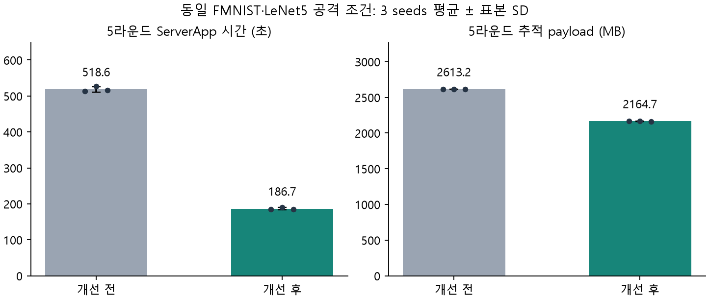

# ACK·동기화 비용 개선 결과

기존 ACK 회수 지연과 이력 재전송을 수정하고, 완전히 동일한 공개 입력 snapshot의 반복 검증을 줄였다. MPC 회로·출력·정적 바운더리·신뢰 모델은 그대로다. Flower Hub 게시 설정은 변경하지 않았다.

## 구현

- 학습 응답 수집 중과 committee RPC 대기 중에도 메인 스레드에서 ACK를 회수한다. RPC는 완료/실패를 확인하고 join한 뒤 진행하며 Grid를 작업 스레드에서 접근하지 않는다.
- Commit TTL은 max(60초, deployment timeout)이다. ACK가 실패하거나 5초 이상 지연되면 제한된 빈도로 현재 durable head를 조회한다. nonce·node·session·client 서명과 서버가 보유한 결정/모델 hash가 모두 맞을 때만 전달 cursor를 전진시킨다.
- ACK/head proof는 전달 최적화용이다. 악성 클라이언트가 자신의 cursor를 거짓으로 주장해도 다른 클라이언트나 QC/MPC 판정이 바뀌지 않는다. ACK는 quorum·다음 라운드·결과 적용의 전제 조건이 아니다.
- 입력 snapshot 검증 cache는 committee 인스턴스당 최대 2개다. 전체 canonical transcript와 policy·registry·contract·session 등 보안 설정의 SHA-256 digest가 일치해야 한다. 처음 보는 내용은 서명·좌표 coverage·context를 모두 검증한다. mutable snapshot은 저장하지 않고 frozen context만 저장한다.
- QC 서명·모델/부모 결정·round 순서·durable lock은 cache로 생략하지 않는다. 재시작/새 인스턴스는 처음부터 검증한다. 캐시는 SHA-256 충돌 저항성과 기존 로컬 실행 환경의 무결성을 전제로 한다.

## 동일 조건 재측정

FMNIST 전체 60,000/10,000개, LeNet5 61,706 parameters, 4 clients, 4 aggregators, 5 rounds, seed 42/43/44, static real L2≤5·coordinate≤20,000이다. 정상 seed42와 공격 3 seeds 각각 평문 평균·평문 bound·실제 MPC를 새 Flower 런타임에서 학습했다(12회/60 rounds). 기존 SGD 산출물을 시간 측정에 재사용하지 않았다. 공격은 C0의 norm≈10 업데이트다.

정상 seed42의 첫 평문 시간 측정은 중간 실험의 종료·정리와 겹쳤다. 정상 비용을 대표하는 배율로 사용하지 않으며, 아래 요약과 평문 대비 핵심 배율은 정리 완료 후 실행한 공격 3 seeds를 기준으로 한다.

| 공격 3 seeds 평균, 5 rounds | 개선 전 | 개선 후 | 감소 |
|---|---:|---:|---:|
| ServerApp 초 | 518.61 | 186.69 | 64.0% |
| Flower CLI 초 | 538.81 | 197.18 | 63.4% |
| 수집·manifest 초 | 357.79 | 93.01 | 74.0% |
| 추적 payload MB | 2613.16 | 2164.74 | 17.2% |
| Flower 서버→클라이언트 MB | 719.51 | 271.07 | 62.3% |
| MPC Player 4-party 송신 MB | 1369.29 | 1369.29 | 0.0% |



동일 입력·모델인 평문 bound 대비 ServerApp 시간 배율은 **14.43× → 5.12×**다. 추적 payload 배율은 117.28× → 97.16×다. 3 seeds 평균의 비율이며 개별 비율의 평균과 구분한다.

ServerApp에는 초기 등록·평가·학습·수집·MPC·인증·모델 적용·통지가 포함된다. 준비/컴파일·사후 oracle 시간은 별도로 기록했다. 관측 payload는 Flower 논리 graph/RPC body/native Player 송신이며 TCP/TLS wire나 미추적 IPC 전체가 아니다. 각 링크에서 한 경계만 세었지만 Flower의 메시지 간 객체 중복 제거/캐시는 할인하지 않은 지표다.

## 라운드별 추세 및 ACK

| 조건/seed | 전→후 ServerApp 초 | 전 round 1~5 초 | 후 round 1~5 초 | 후 confirmed head C0~C3 |
|---|---:|---|---|---|
| clean/42 | 511.18→193.70 | 37.94 / 70.16 / 102.22 / 129.27 / 161.87 | 31.14 / 40.53 / 36.76 / 36.13 / 37.95 | 4 / 4 / 4 / 4 |
| norm-overflow/42 | 512.82→184.84 | 35.83 / 70.66 / 102.01 / 132.20 / 165.01 | 27.56 / 37.67 / 35.77 / 35.22 / 37.80 | 4 / 4 / 4 / 4 |
| norm-overflow/43 | 526.85→190.38 | 37.71 / 72.29 / 104.63 / 136.54 / 168.49 | 29.92 / 36.03 / 41.00 / 37.44 / 37.72 | 4 / 4 / 4 / 4 |
| norm-overflow/44 | 516.14→184.85 | 36.10 / 72.35 / 103.45 / 130.32 / 166.93 | 26.62 / 36.20 / 38.52 / 37.03 / 37.52 | 5 / 4 / 4 / 4 |

마지막 ACK drain은 0.5초 best-effort이므로 마지막 round의 ACK가 모두 회수되는 것을 완료 조건으로 삼지 않는다. 오프라인 복귀자는 필요한 suffix 전체를 검증한다. 정상 경로의 비용 개선이 임의의 dropout 패턴에서도 같은 시간 절감을 보장하는 것은 아니다.

## 검증과 남은 비용

- 개선 전·후 **80개 client-round 정수 입력**, 모든 모델·SUM·count·정확도가 정확히 일치했다. 개선 후 평문 bound↔MPC 입력 일치도 별도로 확인했다.
- 관련 회귀 테스트 519개 통과. cache 내용/서명/policy/registry/session 변조, QC 부족, nonce/node/signer/session/head 변조, ACK 유실 복구, RPC 실패 join을 포함한다.
- 실제 Flower·Rep4 dropout 10 rounds에서 부분 제출·사전 dropout·전 클라이언트 commit ACK 유실·복귀·abort·±80,000 wide SUM을 oracle와 대조했다.
- 저장소 전체 테스트는 외부 원본 Aion fixture 파일 부재로 실패 1건을 관측한 후 중단했다. 전체 성공을 주장하지 않는다. 관련 회귀 테스트와 실제 MPC 실험은 통과했다.
- native MPC 송신량은 동일하다. 큰 모델/많은 clients에 대한 MPC 자체의 비용 문제는 남는다. 독립 물리 호스트의 배포/latency 검증과 전체 composition 프라이버시 증명을 대신하지 않는다.

[개선 후 평문 대비 비용 상세](flower-cost-improved-2026-10-12.md), [이전 병목 진단](flower-cost-bottleneck-2026-10-12.md), [전후 비교 JSON](flower-cost-improvement-2026-10-12/results.json).

```bash
.venv/bin/python -m experiments.export_flower_cost_improvement \
  --before .cache/flower-cost-comparison-2026-10-12-v2 \
  --after .cache/flower-cost-improved-2026-10-12-v2 \
  --report docs/reproduction/flower-cost-improvement-2026-10-12.md
```
