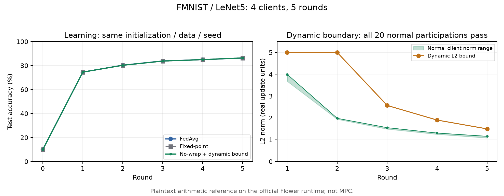

# Flower FMNIST: no-wrap 산술·동적 boundary 로컬 검증

2026-10-10 (KST). 브랜치 `work/aion-private-bound-no-wrap`.

**공식 Flower Simulation Runtime에서 학습 및 평문 산술 검증을 완료했다.**
새 비공개 MPC 경로를 전체 FMNIST 모델에 연결한 실행은 아니다. 루트
`pyproject.toml`, publisher/Hub 게시·배포 설정은 변경하지 않았다. 실행에
필요한 로컬 FAB와 SuperLink 설정만 ignored `.cache` 아래에 만들었다.

## 결과

| 경로 | 5라운드 최종 test accuracy | 정상 제외 / 참여 | abort |
|---|---:|---:|---:|
| FedAvg | 86.26% | 0 / 20 | 0 |
| 고정소수점, 필터 없음 | 86.37% | 0 / 20 | 0 |
| no-wrap + 동적 boundary | 86.37% | 0 / 20 | 0 |

- 매 라운드 학습 업데이트에 M=1/d=1, M=15/d=21,
  M=840000021/d=21, M=2^128/d=21을 적용했다.
- **60개 profile/round 검사에서 좌표 복원 오차 및 정수 SUM 오차가 0**이었다.
  mask 없는 독립 oracle이 squared norm, 선택 인원, integer SUM을 계산하여
  실제 offset/mask reference 결과와 비교했다.
- M=1의 counterfactual centered-modulo decoder는 919,316개 좌표/round
  결과에서 정수 합과 alias된다. 이는 3개 경로의 15라운드를 합한 수다.
  원본 Aion을 그대로 FMNIST에 실행하여 그 횟수만큼 실패시켰다는 뜻은 아니다.
- 정상 업데이트가 모두 통과하여 고정소수점과 no-wrap 경로의 **모든
  라운드 모델이 정확히 일치**했다. 마스크 크기를 바꾸어도 선택 결과는 같았다.
- float FedAvg와 fixed-point의 최대 모델 좌표 차이는 0.0517791이었다.
  학습 경로가 누적해서 달라질 수 있으므로 이 값을 단일 round 양자화
  오차로 해석하지 않는다. 단일 좌표 양자화 오차는 0.00005 이하였다.
- 첫 라운드의 client별 update hash는 세 경로에서 동일했다.
- 동적 bound를 저장된 공개 aggregate SUM/count로부터 독립 replay하여
  모든 라운드에서 일치하는 것을 확인했다.

0.11%p의 정확도 차이는 단일 seed의 관측값이며 개선 효과를 입증하지 않는다.
정상 참여 20회에서 제외가 없었다는 결과 역시 일반적인 오탐률 0 보장이 아니다.



전체 지표·버전·프로필 폭은 [결과 JSON](fmnist-no-wrap-2026-10-10/results.json)에 있다.

## 동적 boundary와 산술 상한

S=10000, 고정 좌표 cap B=20000 (실수 업데이트 좌표 절댓값 2)이다.
cap을 넘는 업데이트는 clipping하거나 정수형에 먼저 캐스팅하지 않고
실험을 실패시킨다. 실제 관측 입력은 cap을 지켰다. no-wrap reference는
Python arbitrary-precision integers로 mask scaling과 복원을 수행한다.

학습 입력을 보기 전에 squared L2 bound를 다음으로 고정했다.

- boot: 25*S^2 (L2 radius 5)
- floor: 0.25*S^2 (radius 0.5)
- maximum: 400*S^2 (radius 20)
- eta 범위 [1/4,4], epsilon_squared=1 (정수 업데이트 단위)

처음 두 성공 라운드는 boot를 사용한다. 이후 허용된 공개 SUM/count에서
RoundEven 정수 평균 g를 계산하고, Q=||g||^2로 기존 DynamicBound를 갱신한다.
mask의 크기나 mask norm은 Q와 T에 들어가지 않는다.

| round | T/S^2 (squared L2 bound) | 통과 인원 |
|---|---:|---:|
| 1 | 25.00000000 | 4 |
| 2 | 25.00000000 | 4 |
| 3 | 6.60623129 | 4 |
| 4 | 3.60774128 | 4 |
| 5 | 2.23635637 | 4 |

이 threshold는 최초 pilot의 사전 설정이다. 공격 방어를 위한 보정 결과가 아니다.
상한을 더 줄이는 추가 실험을 같은 frozen 입력에 반복 질의하는 실제 비공개
서비스로 구현해서는 안 되며, 재질의 방지는 MPC/BFT 연결 단계의 별도 과제다.

## 실험 조건과 런타임

- 공식 Flower 1.36.0 / Ray 2.55.1, `flwr run`과 로컬 SuperLink 사용.
  자체 mock Grid 실행이 아니다.
- run ID `13535648581854286680`, `finished:completed`를 CLI 상태로 확인했다.
- PyTorch 2.8.0+cu128, NVIDIA GeForce RTX 5060, GPU worker 1개.
  모든 60개 학습 응답에서 `cuda:0` 실행을 확인했다. CUDA preflight도 통과했다.
- FMNIST 전체 train 60,000 / test 10,000. seed 42로 IID permutation하여
  15,000장씩 4개 shard에 배분했다. 모든 client가 매 라운드 참여했다.
- LeNet5 61,706 parameters, 새 seed 초기 모델. pretrained checkpoint를 쓰지 않았다.
- 세 경로 각각 5라운드, local epoch 1, batch 64, local SGD learning rate 0.01,
  momentum 0.9, weight decay 0.0005. 각 학습 응답에서 optimizer 235 steps를 확인했다.
- 기존 workload의 normalization(mean 0.1307 / std 0.3081)을 재사용했다.
- 동일 초기 모델·shard·batch schedule을 사용한다. 2라운드 이후 각 경로의
  모델은 달라질 수 있다. 매 경로/라운드 내부의 4개 M 프로필에는 **같은
  frozen update와 같은 boundary**를 사용한다.
- 세 경로 전체의 `flwr run` wall time 약 77.97초. 이는 평문 학습/산술
  경로 시간이며 native MPC 비용과 비교 가능한 secure-FL 실행 시간이 아니다.

원본 HPRF adapter의 p/q와 공개 통제 행렬 [1,2]를 사용했다. 저자 artifact
행렬 및 원본 Aion의 전체 암호 프로토콜을 재현하는 검증으로 확대하지 않는다.

## 추가한 코드와 재현

- `trustlessfl/fmnist_no_wrap_app.py`: 새 로컬 Flower Message API client/server 앱.
- `trustlessfl/fmnist_no_wrap_math.py`: cap 검사, 양자화, 독립 oracle와 mask profile 감사.
- `experiments/run_fmnist_no_wrap.py`: 데이터/초기 모델 staging, 공식 실행, 결과 검증.
- `experiments/export_fmnist_no_wrap.py`: 공개 결과와 scientific plot 내보내기.
- `tests/test_fmnist_no_wrap_math.py`: 작은/큰 mask, 필터, abort, quantization cap 검증.

WSL 저장소 루트에서 새 output 디렉터리를 지정한다.

```sh
.venv/bin/python -m experiments.run_fmnist_no_wrap --output .cache/fmnist-no-wrap/my-clean-pilot --phase prepare
.venv/bin/python -m experiments.run_fmnist_no_wrap --output .cache/fmnist-no-wrap/my-clean-pilot --phase run
.venv/bin/python -m experiments.run_fmnist_no_wrap --output .cache/fmnist-no-wrap/my-clean-pilot --phase verify
```

기본 값은 GPU/4 clients/5 rounds다. prepare와 run을 별도 프로세스로 실행하여
staging 때의 PyTorch 메모리를 runtime 시작 전에 반환한다. CPU는 prepare 시
`--device cpu`를 지정한다. run/verify는 staging한 설정을 그대로 읽는다.
다운로드가 필요한 경우 prepare가 공식 FMNIST IDX checksum을 검증한다.

실제 실행 output:
`.cache/fmnist-no-wrap/clean-4c-5r-20261010-v2`.
모델 checkpoint, local runtime logs, source snapshot은 여기 보존했다.
첫 staging에서 CLI PATH가 누락된 오류를 수정하여 v2에서 정상 실행했다.
학습 후 verifier에 공개 history replay/source snapshot 검사를 추가하고
동일 성공 결과를 재검증했다. 학습 앱은 다시 변경하지 않았다.

관련 검증 결과: 새 산술 tests 6 passed; 기존 private-bound/private-input 포함
67 passed; FMNIST 학습/official comparison/Flower helper 회귀 51 passed,
1 skipped (저자 artifact를 요구하는 기존 비교). `git diff --check` 통과.

plot exporter는 로컬 가상환경에 추가 설치한 matplotlib 3.11.2를 사용한다.
프로젝트 dependency/lockfile은 변경하지 않았다. 그림은 PNG/SVG로 내보냈고
PNG의 축·범례·내용을 시각적으로 확인했다.

## 아직 확인하지 않은 것

이번 Flower 앱은 client delta와 reference mask를 서버가 평문으로 계산하는
공개 데이터 시험이다. 실제 프로토콜의 공개 출력 정책과 혼동해서는 안 된다.
client norm min/max는 이 연구용 진단이며 production MPC의 허용 출력이 아니다.

전체 모델 MPC, 기존 VSS key import, BFT/재질의 차단, malicious committee,
non-IID 정상 오탐, poisoning 탐지, 다중 seed 일반화 및 대규모 통신비는
이 실험으로 검증하지 않았다. 별도 native MPC fixture 8건과도 범위를 구분한다.

이번 결과는 **실제 학습 업데이트에서도 no-wrap 산술이 정확하고, 사전 설정한
동적 threshold가 이 clean IID 학습을 방해하지 않았음**을 보여준다.
보안·공격 방어·배포 가능성을 확정하는 결과는 아니다.
