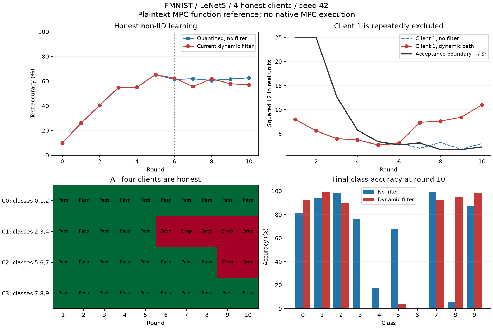

# MPC-Aion 연합학습 과정 검토

**후속 변경: 이 문서는 교체 전 동적 정책의 감사 기록이다. 이후 정적 threshold로 별도 재학습했고, non-IID 10라운드 62.68%, 정상 제외 0/40건을 확인했다. 아래의 “정적 재학습 미실행”은 당시 상태이며 후속 실행으로 갱신됐다.** [현재 정적 정책과 검증](static-threshold-2026-10-10.md).

2026-10-10. 브랜치 `work/aion-private-bound-no-wrap`.

**판정: MPC로 각 업데이트를 정확히 복원해도, 현재 평균 norm 기반 동적 필터가 정상 non-IID 클라이언트를 반복적으로 제외하고 학습을 손상시킬 수 있다. 실제 FMNIST 로컬 학습으로 이 문제가 재현됐다. no-wrap 산술 자체의 오류와 구분해야 한다.**

이번 질문은 연합학습의 모델 생성·집계·라운드 진행에 대한 것이다. TLS나 임의 scalar 누출 반례를 핵심 판단 근거로 사용하지 않았다. 기존 Flower pilot의 실제 학습 코드와 제안 MPC의 출력 함수에 맞춘 평문 reference로 검토했다. **전체 모델 native MPC 또는 새 공식 Flower 실행을 했다는 뜻은 아니다.**

## 실제 실행한 검증

기존 성공 Flower 실험의 FMNIST train 60,000 / test 10,000 및 seed 42 초기 LeNet5 checkpoint를 그대로 재사용했다. 61,706개 전체 parameter를 학습·집계했다. 각 15,000장인 정상 클라이언트 4명에게 label-sorted non-IID partition을 배정했다.

| client | 클래스별 학습 자료 |
|---|---|
| 0 | class 0: 6,000 / 1: 6,000 / 2: 3,000 |
| 1 | class 2: 3,000 / 3: 6,000 / 4: 6,000 |
| 2 | class 5: 6,000 / 6: 6,000 / 7: 3,000 |
| 3 | class 7: 3,000 / 8: 6,000 / 9: 6,000 |

동일 초기 모델과 데이터, client/round seed, local SGD 설정으로 두 학습 trajectory를 각각 10라운드 실행했다. 매 라운드 현재 글로벌 모델에서 로컬 학습을 새로 수행했으며, 고정된 업데이트를 여러 번 집계해 성능을 추정한 실험이 아니다.

- local epoch 1, batch 64, learning rate 0.01, momentum 0.9, weight decay 0.0005.
- S=10000, 좌표 B=20000, boot squared bound 25*S², floor 0.25*S², max 400*S².
- 80건의 로컬 학습을 모두 GPU cuda:0에서 수행했다. 각 235 optimizer steps.
- 공격자 0명, dropout 0명, 학습 설정 변경 없음.
- `quantized-unfiltered`: 정수 양자화 후 모든 업데이트 평균.
- `no-wrap-dynamic`: 동일 양자화 후 현재 DynamicBound 및 정확한 개별 unmask/좌표 검사/norm 검사/통과 합계.
- M=1, d=1. 원본 HPRF adapter p/q, 공개 통제 행렬 [1,2]. 별도의 backend 보안 주장이 아니다.
- 매 라운드 마스크 없는 독립 정수 SUM oracle과 reference를 비교했다. 모두 일치했다.

실행 시간 약 49.55초는 평문 학습/함수 검증 시간이다. native MPC 처리 시간이나 Flower 배포 성능으로 해석하지 않는다. 최초 실행은 CUDA deterministic 환경변수 누락으로 초기 학습에서 중단됐다. `CUBLAS_WORKSPACE_CONFIG=:4096:8`을 설정하고 v2를 새 디렉터리에 처음부터 정상 실행했다.

## 관측 결과

| 경로 | 10라운드 전체 정확도 | 정상 업데이트 탈락 | abort |
|---|---:|---:|---:|
| 양자화, 필터 없음 | 62.68% | 0 / 40 | 0 |
| 현재 no-wrap + 동적 필터 | 57.10% | 7 / 40 | 0 |

단일 seed의 강한 non-IID 설정에서 5.58%p 차이가 관측됐다. 모든 non-IID 설정에서 동일하게 악화된다고 일반화하지 않는다. 필터 없는 경로의 정확도도 낮으므로 일반적인 non-IID client drift와 현재 필터의 추가 영향을 분리해야 한다. 양쪽 모두 5라운드까지 모델이 bitwise 동일했고, 6라운드 첫 필터 제외부터 trajectory가 달라졌다.

| round | 현재 T/S² | client 1의 ||u||²/S² | 통과 client | 정확도 |
|---|---:|---:|---|---:|
| 5 | 3.3469 | 2.7035 | 0,1,2,3 | 65.27% |
| 6 | 2.7302 | 3.0226 | 0,2,3 | 62.47% |
| 7 | 3.1148 | 7.3557 | 0,2,3 | 55.66% |
| 8 | 1.7408 | 7.6244 | 0,2,3 | 61.76% |
| 9 | 1.7228 | 8.4331 | 0,3 | 57.91% |
| 10 | 2.2810 | 11.0044 | 0,3 | 57.10% |

client 1은 6–10라운드의 5회 모두 탈락했다. client 2도 9·10라운드에 탈락했다. 모든 입력은 좌표 cap을 지켰고, 최대 좌표 절댓값은 약 0.4881로 cap 2보다 작았다. 관측된 탈락은 wrap나 좌표 상한 위반 때문이 아니며, 정상적으로 학습된 업데이트가 동적 norm boundary를 넘었기 때문이다.

class 3·4의 학습 자료는 client 1에만 있다. 최종 클래스별 정확도는 다음과 같다.

| class | 필터 없음 | 현재 동적 필터 |
|---|---:|---:|
| 3 | 76.0% | 0.0% |
| 4 | 18.0% | 0.0% |

다른 클래스에서는 개선도 있었다. 예를 들어 class 8은 5.6%→95.0%였다. 따라서 모든 클래스가 일괄 악화됐다는 주장이 아니다. 필터가 정상 데이터 집단의 영향력을 바꾸면서 전체 정확도 및 클래스별 균형을 손상시킨 결과다.



전체 지표와 출처 hash: [`results.json`](mpc-aion-learning-2026-10-10/results.json).

## 학습 과정에 대한 해석

현재 경계는 `Q=||RoundEven(SUM/count)||²`의 비율로 다음 T를 갱신한다. 하지만 non-IID에서는 개별 업데이트 방향이 달라 평균은 작아져도 각 client 업데이트 norm은 클 수 있다. 평균 norm과 개별 norm 규모를 동일시할 수 없다. non-IID가 로컬 업데이트의 drift를 만든다는 일반적 배경은 [SCAFFOLD 원논문](https://proceedings.mlr.press/v119/karimireddy20a.html)에서도 분석한다. 이번 수치는 해당 논문에서 가져온 결과가 아니라 우리 저장소의 직접 실행 결과다.

첫 정상 제외 이후 client 1이 담당한 클래스를 글로벌 모델이 덜 학습하게 되고, 그 client의 다음 로컬 업데이트가 더욱 커져 다시 탈락하는 과정이 관측됐다. norm은 3.02→7.36→7.62→8.43→11.00으로 증가했다. 이는 반복 배제의 위험을 뒷받침한다. 모든 학습 불안정성을 이 메커니즘 하나로 설명하는 보편적 인과 증명은 아니다.

mask 크기나 HPRF 복원 정확도를 개선해도 이 선택 정책은 변하지 않는다. 정확한 MPC는 현재 함수를 그대로 실행하므로 같은 입력에서 같은 정상 탈락 결정을 내린다. 필터가 없는 baseline의 관측된 모든 업데이트 norm은 squared real bound 25 이하였다. 따라서 이 한 trajectory에서는 T=25를 고정하면 모든 관측 입력이 통과한다. 별도의 세 번째 고정-T 학습 실행은 하지 않았고, 고정 T가 poisoning까지 해결한다고 주장하지 않는다.

## 학습 파이프라인 단계별 판단

| 단계 | 확인 사항 | 판정 |
|---|---|---|
| 시작 모델 | 실제 모델은 고정 reference + 공개 offset | 현재 실험은 동일 reference, 정상 |
| local update | 학습 후 parameter − 학습 전 parameter | delta를 모델 자체로 혼동하거나 두 번 빼는 오류 없음 |
| 양자화 | RoundEven, S=10000, 범위 확인 후 정수화 | 좌표 오차 <=0.00005, 이번 입력 모두 cap 이내 |
| 개별 unmask | raw offset에서 마스크를 개별 제거 | 모든 20 round/profile SUM oracle 일치 |
| norm 선택 | 현재 평균 기반 T로 개별 norm 비교 | 정상 non-IID client 반복 제외 재현 |
| 평균 집계 | SUM/(S*통과 인원), 총 참여 인원으로 나누지 않음 | 저장된 모든 모델 갱신과 일치 |
| history | 공개 정수 평균의 norm으로 T 갱신 | 구현 식 재현은 일치, 식 자체의 학습 적합성 실패 |
| 다음 라운드 | 갱신된 글로벌 모델에서 재학습 | 양쪽 모두 새 로컬 학습 실행 |

좌표별 양자화 오차 0.00005이면 61,706차원에서 단일 frozen 업데이트 L2 오차의 최악 상한은 약 0.01242다. 정확한 norm 검사도 원래 실수 norm의 판정과 경계 근처에서 달라질 수 있다. 이번 탈락의 주요 사례는 이 오차 범위를 충분히 넘는 norm 차이를 보였으며, max coordinate quantization error와 cap 위반으로 설명되지 않는다. 이 단일-round 오차를 재학습 trajectory의 장기 모델 차이 상한으로 사용하지 않는다.

현재 history는 정수 평균을 RoundEven한 norm이고, 실제 모델에 적용하는 것은 SUM/count의 실수 평균이다. 이것은 명시된 서로 다른 통계 정의이며 wrap 오류는 아니다. 향후 경계 설계를 고칠 때 공개 SUM/count에서 exact rational norm을 사용하는 선택도 비교할 수 있지만, rounding을 없애는 것만으로 non-IID 배제를 해결하지는 않는다.

## 추가로 남아 있는 실제 학습 운영 조건

1. **dropout을 처리하지 못하는 고정 전원 참여 경로.** 기존 Flower 앱의 `ordered`는 네 명 응답이 모두 없으면 예외로 종료한다. 실제 함수에 세 응답을 주어 이 동작을 확인했다. native fixture도 N개 client 연결과 입력을 모두 기다린다. 라운드 명단 확정·타임아웃·abort 후 모델 보존·재참여 처리 정책이 필요하다. 이번 새 학습 실험에서는 dropout을 주입하지 않았다.
2. **좌표 상한 위반의 whole-job 실패.** 현재 평문 Flower 시험은 한 client의 한 좌표가 cap을 넘으면 `quantize` 예외로 전체 실행이 중단된다. real cap 2에 대해 2.0001 입력을 주어 거부를 확인했다. native 회로의 canonical wire 내 oversized coordinate 제외와 구분해야 한다. 정직한 client의 범위 초과를 어떻게 보고하고 라운드를 진행할지 MPC 연결 전에 정해야 한다.
3. **가중치 정의.** 현재는 동일 15,000장씩이므로 단순 client 평균과 sample-weighted 평균이 같다. 일반적인 데이터 수가 다른 client에서는 학습 목적에 맞춰 균등 client 평균 또는 sample-weighted 평균을 명시해야 한다. [FedAvg 원논문](https://proceedings.mlr.press/v54/mcmahan17a.html)은 표본 수에 따른 가중 목적을 사용한다. weighted SUM으로 바꾸면 검증된 weight 상한에 맞춰 no-wrap SUM 폭과 분모도 다시 산정해야 한다.
4. **실제 모델 전체의 결속.** 기존 client metadata의 model hash는 공개 offset만 hash한다. offset이 같아도 reference가 다르면 실제 시작 모델은 다르다. 서로 다른 reference에 같은 offset을 더해 서로 다른 effective model hash가 되는 것을 확인했다. 현재 실험은 같은 reference 파일 hash를 검증해 이 문제가 발생하지 않았지만, 배포 시 reference·architecture·parameter 순서까지 초기 task와 모델 인증서에 결속해야 한다.
5. **모델 일반화.** 현재 코드는 61,706 parameter LeNet5 전용이다. local optimizer를 매 라운드 새로 시작하는 현재 FedAvg 변형은 명시된 선택이다. BatchNorm buffer 등 parameter 외 state가 있는 모델의 지원은 이 검증으로 보장되지 않는다.
6. **MPC 학습 처리량.** 이전 2차원 native fixture조차 수십 초와 수십 GB 통신을 사용했다. 이를 61,706차원 라운드에 연결한 처리량과 timeout은 아직 확인하지 않았다. 정확히 선형으로 비용이 증가한다고 외삽하지 않는다. 평문 FMNIST의 실행 시간으로 MPC 실용성을 판정할 수 없다.

이 항목들은 현재 pilot의 제한 또는 향후 연결 요구 사항이다. dropout이 이번 학습에서 실제 발생했다거나 reference 변조 공격을 실제 네트워크에서 수행했다는 주장이 아니다.

## 재현과 독립 확인

```
cd /home/hacho/@WSL-Projects/trustlessFL
.venv/bin/python -m experiments.audit_mpc_aion_learning --output .cache/fmnist-no-wrap/my-learning-audit
.venv/bin/python -m experiments.verify_mpc_aion_learning --run .cache/fmnist-no-wrap/my-learning-audit
```

실제 실행: `.cache/fmnist-no-wrap/learning-process-noniid-20261010-v2`.

독립 verifier는 source/data hash, 전 라운드 SUM/count 기반 모델 적용, 공개 history 기반 경계 replay, 80개 training workload/device metadata, 첫 정상 탈락 전 모델 동일성을 확인했다. 마지막 checkpoint를 기존 FMNIST evaluator로 다시 평가해 두 최종 정확도도 일치했다. native MPC와 새로운 Flower 통신을 실행한 검증이 아니다.

이번 검토에서는 기존 학습 앱·프로토콜 출력 정책·DynamicBound를 변경하지 않았다. 학습 동작을 조사하는 별도 실행/검증 스크립트와 기록만 추가했다. Hub/publisher/deployment 설정은 건드리지 않았다.

**우선 수정할 것은 평균 norm 기반 동적 T다. 정상 non-IID 클라이언트를 지속적으로 배제하지 않는 정책을 정하고, clean IID/non-IID·불균형·부분 참여에서 클래스별 성능과 정상 통과율을 먼저 검증해야 한다. 그 뒤 동일한 선택 함수와 no-wrap 산술을 native MPC에 연결해 비용·abort·라운드 진행을 검증한다.**
