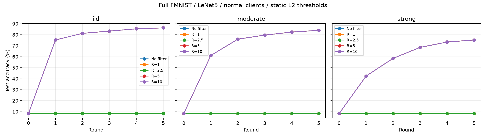
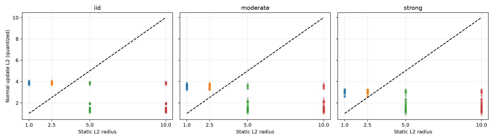

# 정상 클라이언트의 Non-IID·고정 L2 threshold 실험

**반경 5는 정상 입력 300건을 제외하지 않았고, 무필터와 모든 라운드 모델이 같았다.** 5라운드 평균 정확도는 IID 86.24%, 중간 Non-IID 84.00%, 강한 Non-IID 75.23%였다. 반경 1·2.5는 탐색에서 정상 입력을 전부 제외해 학습을 시작하지 못했다. 선정된 반경 5의 실제 MPC 15라운드도 평문 기준과 정확히 일치했다.

실제 수행 결과. 공격 없이 정상 SGD 업데이트만 제출하고, threshold로 인한 제외와 학습 변화를 비교했다.

실행 범위: **평문 탐색 45회·225라운드 + 새로운 seed 평문 확인 6회·60라운드**, **실제 Flower·active Rep4 3회·15라운드**. MPC backend는 MP-SPDZ 0.4.3의 검증된 holder-checked direct importer 경로다. 작은 반경의 abort 결과는 평문 기준 실험이며, 이번 실제 MPC 대조는 선택된 반경 5에 한정했다.

## 설정과 분할

- Full Fashion-MNIST train 60,000 / test 10,000, LeNet5 61,706개 파라미터, 클라이언트 4명·각 15,000개.
- Local epoch 1, batch 64, CPU SGD lr .01 / momentum .9 / weight decay .0005. 각 local 호출에서 optimizer를 새로 만든다.
- 탐색: seed 42·43·44, 5라운드, 분포 3개 × 무필터/반경 1·2.5·5·10 = **45회·225라운드**.
- S=10,000, Q=65,536, 좌표 B=20,000(실수 2), 최소 통과 2. norm 제곱 기준은 T=(SR)². 모든 정책은 세션 시작 전에 고정.
- 중간/강한 분할: Dirichlet α=.5/.1의 클래스 선호를 행·열 합에 맞춰 조정한 **동일 크기 제약 label skew**. 일반적인 무제약 Dirichlet 분할과 다르다.
- 모든 학습 행을 중복 없이 한 번 배정했다. 아래 실제 클래스 개수와 entropy를 확인해야 α만으로 분포를 해석하지 않는다.
- 동일 seed/분포에서 초기 모델과 샤드를 맞추고, 집계가 달라진 뒤에는 각 조건의 현재 모델에서 다시 학습한다. Cache는 seed·분포·round·slot·현재 모델 hash로 구분한다.
- 평문 기준에서 count<2인 라운드는 abort로 기록해 모델을 유지하고 다음 라운드로 진행한다. 이 경우를 삭제하거나 성공 실행으로 바꾸지 않았다.

## 5라운드 결과

평균 ±는 3개 seed의 표본 표준편차(%p)이며 신뢰구간이 아니다. 제외율 분모는 조건당 정상 제출 60건이다.

| 분포 | L2 반경 | seed별 정확도(%) | 평균 ± 표준편차 | 정상 제외 | abort 라운드 |
|---|---|---|---|---|---|
| IID | 무필터 | 86.24 / 86.07 / 86.42 | 86.24 ± 0.18 | 0/60 | 0/15 |
| IID | 1.0 | 10.00 / 5.22 / 9.79 | 8.34 ± 2.70 | 60/60 | 15/15 |
| IID | 2.5 | 10.00 / 5.22 / 9.79 | 8.34 ± 2.70 | 60/60 | 15/15 |
| IID | 5.0 | 86.24 / 86.07 / 86.42 | 86.24 ± 0.18 | 0/60 | 0/15 |
| IID | 10.0 | 86.24 / 86.07 / 86.42 | 86.24 ± 0.18 | 0/60 | 0/15 |
| 중간 Non-IID | 무필터 | 83.34 / 85.20 / 83.46 | 84.00 ± 1.04 | 0/60 | 0/15 |
| 중간 Non-IID | 1.0 | 10.00 / 5.22 / 9.79 | 8.34 ± 2.70 | 60/60 | 15/15 |
| 중간 Non-IID | 2.5 | 10.00 / 5.22 / 9.79 | 8.34 ± 2.70 | 60/60 | 15/15 |
| 중간 Non-IID | 5.0 | 83.34 / 85.20 / 83.46 | 84.00 ± 1.04 | 0/60 | 0/15 |
| 중간 Non-IID | 10.0 | 83.34 / 85.20 / 83.46 | 84.00 ± 1.04 | 0/60 | 0/15 |
| 강한 Non-IID | 무필터 | 68.87 / 78.68 / 78.13 | 75.23 ± 5.51 | 0/60 | 0/15 |
| 강한 Non-IID | 1.0 | 10.00 / 5.22 / 9.79 | 8.34 ± 2.70 | 60/60 | 15/15 |
| 강한 Non-IID | 2.5 | 10.00 / 5.22 / 9.79 | 8.34 ± 2.70 | 60/60 | 15/15 |
| 강한 Non-IID | 5.0 | 68.87 / 78.68 / 78.13 | 75.23 ± 5.51 | 0/60 | 0/15 |
| 강한 Non-IID | 10.0 | 68.87 / 78.68 / 78.13 | 75.23 ± 5.51 | 0/60 | 0/15 |





무필터·반경 5·10 곡선은 모델이 같아 겹친다. 반경 1·2.5 곡선도 초기 모델이 유지돼 겹친다. Norm 그림의 검은 점선은 허용 반경이다.

## 클라이언트별 제외와 검사 원인

| 분포 | 반경 | C0 / C1 / C2 / C3 제외(각 15건) | 좌표 초과 | L2 초과 |
|---|---|---|---|---|
| IID | 1.0 | 15 / 15 / 15 / 15 | 0 | 60 |
| IID | 2.5 | 15 / 15 / 15 / 15 | 0 | 60 |
| IID | 5.0 | 0 / 0 / 0 / 0 | 0 | 0 |
| IID | 10.0 | 0 / 0 / 0 / 0 | 0 | 0 |
| 중간 Non-IID | 1.0 | 15 / 15 / 15 / 15 | 0 | 60 |
| 중간 Non-IID | 2.5 | 15 / 15 / 15 / 15 | 0 | 60 |
| 중간 Non-IID | 5.0 | 0 / 0 / 0 / 0 | 0 | 0 |
| 중간 Non-IID | 10.0 | 0 / 0 / 0 / 0 | 0 | 0 |
| 강한 Non-IID | 1.0 | 15 / 15 / 15 / 15 | 0 | 60 |
| 강한 Non-IID | 2.5 | 15 / 15 / 15 / 15 | 0 | 60 |
| 강한 Non-IID | 5.0 | 0 / 0 / 0 / 0 | 0 | 0 |
| 강한 Non-IID | 10.0 | 0 / 0 / 0 / 0 | 0 | 0 |

좌표/L2 초과는 겹칠 수 있다. C 번호는 seed별 재분할되는 슬롯으로 동일 사람을 의미하지 않는다. 개별 norm/판정은 trusted 연구용 audit 지표이며 운영 서버에 새로 공개한 정보가 아니다.

## 실제 데이터 분포

| seed | 분포 | 평균 클래스 entropy(bits) |
|---|---|---:|
| 42 | IID | 3.3214 |
| 42 | 중간 Non-IID | 2.7760 |
| 42 | 강한 Non-IID | 2.1189 |
| 43 | IID | 3.3216 |
| 43 | 중간 Non-IID | 2.8775 |
| 43 | 강한 Non-IID | 1.8849 |
| 44 | IID | 3.3216 |
| 44 | 중간 Non-IID | 2.7338 |
| 44 | 강한 Non-IID | 2.0364 |
| 45 | 강한 Non-IID | 1.8490 |
| 46 | 강한 Non-IID | 1.9293 |
| 47 | 강한 Non-IID | 2.2014 |

### seed 42 · IID

| client | class 0 | 1 | 2 | 3 | 4 | 5 | 6 | 7 | 8 | 9 |
|---|---:|---:|---:|---:|---:|---:|---:|---:|---:|---:|
| C0 | 1458 | 1477 | 1516 | 1477 | 1466 | 1530 | 1514 | 1524 | 1480 | 1558 |
| C1 | 1566 | 1556 | 1516 | 1451 | 1505 | 1494 | 1417 | 1506 | 1478 | 1511 |
| C2 | 1501 | 1537 | 1490 | 1526 | 1458 | 1492 | 1572 | 1451 | 1546 | 1427 |
| C3 | 1475 | 1430 | 1478 | 1546 | 1571 | 1484 | 1497 | 1519 | 1496 | 1504 |

### seed 42 · 중간 Non-IID

| client | class 0 | 1 | 2 | 3 | 4 | 5 | 6 | 7 | 8 | 9 |
|---|---:|---:|---:|---:|---:|---:|---:|---:|---:|---:|
| C0 | 2255 | 848 | 1 | 2036 | 4295 | 2215 | 1255 | 1916 | 164 | 15 |
| C1 | 1968 | 505 | 738 | 1282 | 204 | 1763 | 2322 | 699 | 1602 | 3917 |
| C2 | 1773 | 4602 | 270 | 2191 | 1000 | 1131 | 285 | 1789 | 306 | 1653 |
| C3 | 4 | 45 | 4991 | 491 | 501 | 891 | 2138 | 1596 | 3928 | 415 |

### seed 42 · 강한 Non-IID

| client | class 0 | 1 | 2 | 3 | 4 | 5 | 6 | 7 | 8 | 9 |
|---|---:|---:|---:|---:|---:|---:|---:|---:|---:|---:|
| C0 | 430 | 27 | 0 | 22 | 5990 | 5263 | 691 | 1975 | 598 | 4 |
| C1 | 5190 | 0 | 0 | 2250 | 3 | 0 | 239 | 2935 | 0 | 4383 |
| C2 | 380 | 0 | 4118 | 3723 | 5 | 50 | 321 | 864 | 3926 | 1613 |
| C3 | 0 | 5973 | 1882 | 5 | 2 | 687 | 4749 | 226 | 1476 | 0 |

### seed 43 · IID

| client | class 0 | 1 | 2 | 3 | 4 | 5 | 6 | 7 | 8 | 9 |
|---|---:|---:|---:|---:|---:|---:|---:|---:|---:|---:|
| C0 | 1522 | 1445 | 1441 | 1488 | 1526 | 1562 | 1512 | 1497 | 1516 | 1491 |
| C1 | 1541 | 1470 | 1495 | 1541 | 1471 | 1479 | 1511 | 1482 | 1509 | 1501 |
| C2 | 1452 | 1524 | 1593 | 1448 | 1488 | 1469 | 1473 | 1534 | 1478 | 1541 |
| C3 | 1485 | 1561 | 1471 | 1523 | 1515 | 1490 | 1504 | 1487 | 1497 | 1467 |

### seed 43 · 중간 Non-IID

| client | class 0 | 1 | 2 | 3 | 4 | 5 | 6 | 7 | 8 | 9 |
|---|---:|---:|---:|---:|---:|---:|---:|---:|---:|---:|
| C0 | 1941 | 2991 | 2546 | 540 | 1771 | 662 | 179 | 1600 | 2406 | 364 |
| C1 | 1064 | 992 | 2199 | 3911 | 716 | 580 | 2147 | 221 | 569 | 2601 |
| C2 | 1105 | 1353 | 1222 | 954 | 1694 | 27 | 3077 | 4102 | 158 | 1308 |
| C3 | 1890 | 664 | 33 | 595 | 1819 | 4731 | 597 | 77 | 2867 | 1727 |

### seed 43 · 강한 Non-IID

| client | class 0 | 1 | 2 | 3 | 4 | 5 | 6 | 7 | 8 | 9 |
|---|---:|---:|---:|---:|---:|---:|---:|---:|---:|---:|
| C0 | 812 | 548 | 0 | 1666 | 5306 | 483 | 156 | 0 | 32 | 5997 |
| C1 | 5020 | 4544 | 55 | 0 | 316 | 4998 | 0 | 66 | 0 | 1 |
| C2 | 20 | 31 | 51 | 2623 | 0 | 10 | 362 | 5934 | 5968 | 1 |
| C3 | 148 | 877 | 5894 | 1711 | 378 | 509 | 5482 | 0 | 0 | 1 |

### seed 44 · IID

| client | class 0 | 1 | 2 | 3 | 4 | 5 | 6 | 7 | 8 | 9 |
|---|---:|---:|---:|---:|---:|---:|---:|---:|---:|---:|
| C0 | 1513 | 1529 | 1506 | 1525 | 1517 | 1504 | 1458 | 1473 | 1478 | 1497 |
| C1 | 1530 | 1569 | 1459 | 1496 | 1516 | 1471 | 1512 | 1461 | 1539 | 1447 |
| C2 | 1478 | 1443 | 1545 | 1508 | 1499 | 1525 | 1519 | 1518 | 1487 | 1478 |
| C3 | 1479 | 1459 | 1490 | 1471 | 1468 | 1500 | 1511 | 1548 | 1496 | 1578 |

### seed 44 · 중간 Non-IID

| client | class 0 | 1 | 2 | 3 | 4 | 5 | 6 | 7 | 8 | 9 |
|---|---:|---:|---:|---:|---:|---:|---:|---:|---:|---:|
| C0 | 683 | 32 | 1185 | 1282 | 1677 | 3351 | 3095 | 3527 | 96 | 72 |
| C1 | 2127 | 172 | 105 | 2049 | 786 | 1756 | 1577 | 1 | 1986 | 4441 |
| C2 | 3151 | 2818 | 1154 | 1716 | 3388 | 800 | 3 | 2 | 914 | 1054 |
| C3 | 39 | 2978 | 3556 | 953 | 149 | 93 | 1325 | 2470 | 3004 | 433 |

### seed 44 · 강한 Non-IID

| client | class 0 | 1 | 2 | 3 | 4 | 5 | 6 | 7 | 8 | 9 |
|---|---:|---:|---:|---:|---:|---:|---:|---:|---:|---:|
| C0 | 5 | 0 | 109 | 16 | 227 | 4787 | 1227 | 5565 | 3061 | 3 |
| C1 | 3356 | 0 | 0 | 5776 | 77 | 1185 | 4582 | 0 | 10 | 14 |
| C2 | 2639 | 4035 | 477 | 180 | 5696 | 28 | 0 | 0 | 124 | 1821 |
| C3 | 0 | 1965 | 5414 | 28 | 0 | 0 | 191 | 435 | 2805 | 4162 |

## 선택과 새로운 seed 확인

강한 Non-IID 탐색 결과에서 최종 정확도 평균, 적은 제외 수, 기존 반경 5 우선, 작은 반경 순으로 선정했다. 선택된 반경은 **5.0**다.
테스트 정확도를 사용한 선택이므로 탐색 결과다. 새 seed 45·46·47에서 무필터와 선택 반경을 10라운드 비교했다. 데이터 분할·초기화의 반복 확인이며, 같은 FMNIST test set을 다시 사용해 독립 holdout 평가를 대신하지 않는다.

| 강한 Non-IID | seed별 최종 정확도(%) | 평균 ± 표준편차 | 정상 제외 | abort |
|---|---|---|---|---|
| 무필터 | 74.82 / 84.05 / 78.92 | 79.26 ± 4.62 | 0/120 | 0/30 |
| R=5.0 | 74.82 / 84.05 / 78.92 | 79.26 ± 4.62 | 0/120 | 0/30 |

## 실제 Flower·Rep4 검증

강한 Non-IID의 현재 반경 5와 선택 반경을 실제 MPC로 실행했다. 동일 반경이면 중복 실행을 생략한다. 정상 학습 자체를 바꾸거나 synthetic 업데이트로 대체하지 않았다.

| seed | 반경 | 검증 라운드 | 개인 입력 | SUM/count 또는 abort | 모델·accuracy |
|---|---|---:|---|---|---|
| 42 | 5.0 | 5 | 전체 좌표 정확히 일치 | 전체 정확히 일치 | 전체 정확히 일치 |
| 43 | 5.0 | 5 | 전체 좌표 정확히 일치 | 전체 정확히 일치 | 전체 정확히 일치 |
| 44 | 5.0 | 5 | 전체 좌표 정확히 일치 | 전체 정확히 일치 | 전체 정확히 일치 |

Native 검증기는 클라이언트 재학습·샤드 hash·인증서·정수 합·모델을 독립 확인했다. 추가로 평문 cache의 개별 입력과 native client audit을 좌표별 비교했다. 각 loss는 native evaluator로 재검증했으며, 평문 evaluator와의 차이는 JSON에 기록했다.

## 초기 설정과 라운드 비용

네 aggregator의 추적된 native Player payload 송신 합계. live preprocessing 포함, TLS/TCP/framing·미추적 exchange·Flower/RPC 제외. 전체 시스템 통신량이 아니다.

| seed | 반경 | setup bytes | round 1~5 MB(10⁶ bytes) | ServerApp wall 초 | compile 횟수 |
|---|---|---:|---|---:|---:|
| 42 | 5.0 | 33,884 | 274.11 / 273.47 / 274.11 / 273.47 / 274.11 | 478.20 | 1 |
| 43 | 5.0 | 33,884 | 274.11 / 273.47 / 274.11 / 273.47 / 274.11 | 475.38 | 0 |
| 44 | 5.0 | 33,884 | 274.11 / 273.47 / 274.11 / 273.47 / 274.11 | 483.89 | 0 |

Threshold가 다른 정책은 별도 회로/cache key를 사용한다. 동일 정책의 반복은 compile cache를 사용하며 라운드별 재컴파일·seed 재등록은 없다. wall은 학습·수집·MPC·인증을 포함하며 평문 cache 실행과 공정한 속도 비율을 뜻하지 않는다.

## 해석과 한계

- 정상 SGD 업데이트라도 정적 norm 한도를 넘으면 제외된다. 이를 공격 탐지율로 표현하지 않는다.
- 5라운드 결과만으로 수렴 성능을 단정하지 않는다. 새 seed의 10라운드 결과도 이 설정의 짧은 학습 확인이다.
- 제외율이 낮은 큰 threshold가 poisoning 방어에 더 좋다는 뜻은 아니다. 공격/보안 허용 범위를 결정할 근거는 별도다.
- 같은 WSL UID의 trusted Flower Simulation + 실제 active Rep4. 네 독립 운영자의 물리적 배포/공모 시험·DP·전체 프라이버시 증명이 아니다.
- Client 4명, LeNet5, FMNIST, 고정 학습률과 동일 크기 분할의 결과다. 모델·local epoch·분포 변경 시 같은 norm 분포를 가정하지 않는다.
- Seed·개인 키·raw 업데이트·학습 파일은 private .cache에만 보관한다. 공개 JSON에는 연구 통계/hash/equality/counter만 내보낸다.

## 재현

```bash
.venv/bin/python -u -m experiments.run_noniid_threshold \
  --output .cache/new-noniid-threshold \
  --mp-spdz-dir .cache/private-bound-mpc/mp-spdz-0.4.3-direct-rep4-v1 \
  --report docs/reproduction/new-noniid-threshold.md
```

[전체 결과 JSON](noniid-threshold-2026-10-12/results.json), [공개 파일·소스 hash](noniid-threshold-2026-10-12/manifest.json). Hub 게시·계정 설정은 하지 않았다.

## 핵심 해석과 추가 검증

- iid: 반경 5의 평균 정확도 **86.24%**, 정상 제외 **0/60**. 무필터와 모든 라운드 모델이 정확히 같다.
- moderate: 반경 5의 평균 정확도 **84.00%**, 정상 제외 **0/60**. 무필터와 모든 라운드 모델이 정확히 같다.
- strong: 반경 5의 평균 정확도 **75.23%**, 정상 제외 **0/60**. 무필터와 모든 라운드 모델이 정확히 같다.

반경 1·2.5는 탐색의 분포별 **60/60 정상 제출을 제외**했고 각 분포에서 **15/15라운드가 abort**였다. 초기 모델이 갱신되지 않아 정상 norm이 충분히 작아지는 학습 단계에 도달하지 못했다. 제외율을 마지막 라운드 norm만으로 판단해서는 안 된다.

새 seed의 강한 Non-IID 10라운드에서 반경 5와 무필터는 모두 **79.26% ± 4.62%p**, 반경 5의 정상 제외는 **0/120**이었다. 전체 무필터 기준 실행의 첫 라운드 최대 L2는 **3.96968**, 모든 라운드 최대는 **3.96968**였다.

무필터 기준 첫 라운드의 정상 L2 분포(3 seeds × 4 clients)는 다음과 같다.

| 분포 | 최소 | 평균 | 최대 |
|---|---:|---:|---:|
| iid | 3.68107 | 3.85146 | 3.96968 |
| moderate | 3.31951 | 3.54414 | 3.82471 |
| strong | 2.64320 | 3.03599 | 3.25204 |

이 설정에서는 강한 Non-IID의 초기 평균 L2가 IID보다 작았다. 데이터 이질성이 커지면 정상 norm도 반드시 커진다는 가정은 이번 결과와 맞지 않는다.

이번 설정에서는 반경 5를 유지할 근거가 있고, Non-IID 때문에 동적 바운더리가 필요하다는 증거는 없었다. 다만 반경 5·10이 모든 정상 입력을 통과시켰으므로 부분적으로 일부 클라이언트만 제외되는 상황은 이번 후보에서 관측되지 않았다. 더 긴 학습·다른 local epoch나 모델에서 같은 판단을 보장하지 않는다.

반경 2.5~5 사이를 탐색하지 않았으므로 5가 최소 허용값이나 모든 상황의 최적 threshold라는 주장은 하지 않는다. 이번 실험은 공격 없이 정상 학습만 비교했으며 threshold 이내 공격에 대한 성능을 평가하지 않는다.

### 클래스별 정확도

반경 5의 seed별 최종 클래스 정확도를 평균했다. 무필터와 동일하며, class 번호는 FMNIST 원래 label이다.

| 분포/길이 | class 0 | 1 | 2 | 3 | 4 | 5 | 6 | 7 | 8 | 9 |
|---|---:|---:|---:|---:|---:|---:|---:|---:|---:|---:|
| iid/5r | 79.93% | 96.70% | 79.17% | 89.57% | 75.50% | 95.47% | 60.40% | 95.27% | 96.80% | 93.63% |
| moderate/5r | 77.20% | 95.47% | 65.50% | 90.00% | 83.40% | 94.70% | 54.93% | 87.30% | 96.27% | 95.23% |
| strong/5r | 76.43% | 89.27% | 41.30% | 85.87% | 39.03% | 93.80% | 60.60% | 87.80% | 90.47% | 87.70% |
| strong/10r·새 seed | 38.50% | 97.33% | 66.43% | 73.73% | 83.53% | 84.20% | 76.23% | 93.17% | 96.50% | 83.00% |

별도 검증기로 **285라운드·1,140개 client-round**의 norm·좌표 검사·정수 SUM·abort·모델을 private cache에서 Python 정수로 재계산했다. 모두 일치했다. [추가 산술 검증](noniid-threshold-2026-10-12/arithmetic-checks.json). 관련 테스트는 **65 passed**였다.

### 라운드별 시간

학습/수집·입력 인증·실행/결과 인증·적용·client 통지의 측정 단계 합계다. 초기 등록과 최종 shutdown 등 라운드 외 작업은 포함하지 않는다. 실행/결과 인증 시간도 순수 MPC 연산 시간과 동일하지 않다.

| seed | R | compile/cache 조회 | round 1~5 단계 합계(초) | round 1~5 실행·결과 인증(초) |
|---|---|---|---|---|
| 42 | 5.0 | 22.892초 compile | 33.896 / 66.246 / 94.012 / 121.701 / 154.169 | 11.775 / 11.751 / 11.218 / 11.276 / 12.314 |
| 43 | 5.0 | cache hit | 32.747 / 66.540 / 96.123 / 121.765 / 151.482 | 11.294 / 11.705 / 11.441 / 11.205 / 12.058 |
| 44 | 5.0 | cache hit | 32.870 / 65.867 / 95.480 / 123.580 / 156.300 | 11.613 / 11.331 / 11.822 / 11.393 / 13.020 |

```bash
.venv/bin/python -m experiments.verify_noniid_threshold \
  --output .cache/noniid-threshold-2026-10-12 \
  --report docs/reproduction/noniid-threshold-2026-10-12.md
```
