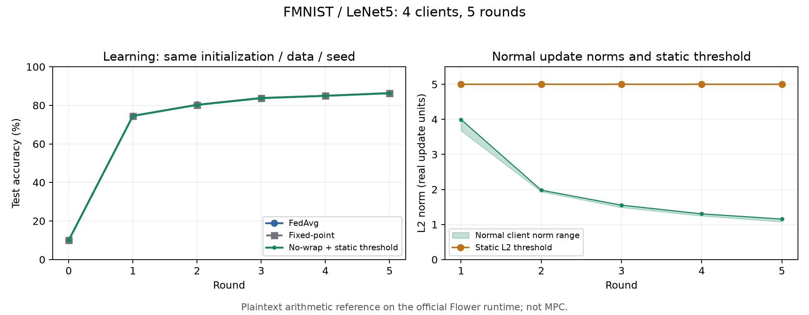
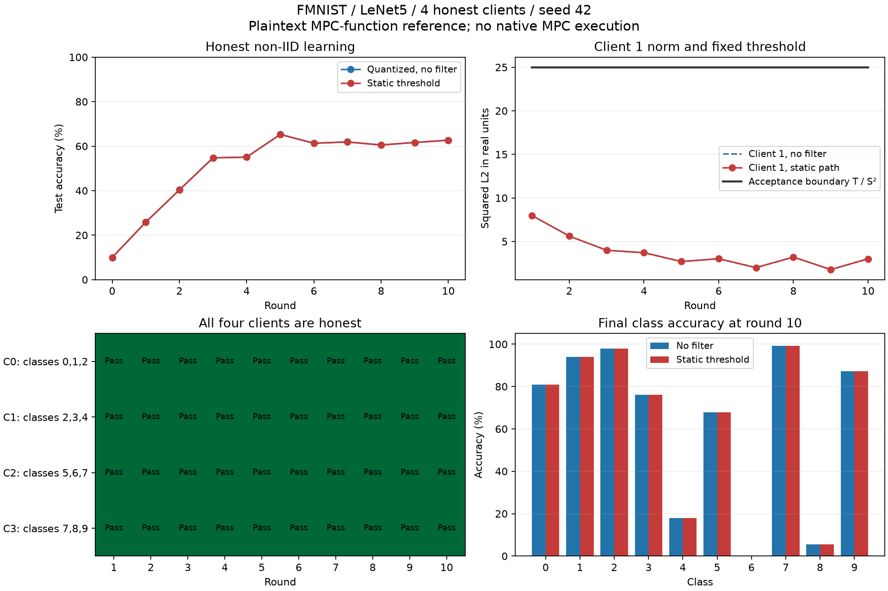

# 정적 threshold 전환 및 FMNIST 재검증

2026-10-10. WSL Ubuntu-24.04, 브랜치 `work/aion-private-bound-no-wrap`.

새 no-wrap 학습 경로는 **업데이트의 L2 반경 5를 학습 시작 전에 고정**한다.
평균 norm, 이전 성공 라운드, abort 결과에 따른 threshold 갱신을 제거했다.
이는 기존 원본 Aion 재현 경로가 아닌 새 비공개 검사/no-wrap 확장의 정책 변경이다.

## 검사와 산술 조건

- 로컬 업데이트는 모델 자체가 아니라 `delta = local_model - global_model`이다.
- `S=10000`, `u=RoundEven(S*delta)`, 고정 `T=25*S²=2,500,000,000`.
- 비밀 복원한 정수 업데이트에 대해 `sum_j u_j² <= T`이면 norm 조건을 통과한다.
- 좌표 조건 `|u_j| <= B`, `B=20000`은 별도로 모두 만족해야 한다. 실수 좌표 cap은 2다.
- 한 좌표라도 잘못된 격자/범위이거나 norm을 초과하면 해당 클라이언트 전체를 제외한다.
  norm clipping으로 변환하는 정책은 아니다. 통과 인원 부족 시 abort한다.
- offset·복원·제곱합·최종 합의 안전 폭은 고정 B, D, 최대 인원 및 M으로 산정한다.
  `T`를 고정하는 조치 자체가 wrap를 없애지는 않는다. 개별 mask를 비밀 계산 안에서
  제거하고 일반 정수 합을 계산하는 기존 no-wrap 산술이 wrap 방지를 담당한다.
- `T`는 양자화된 업데이트의 norm을 검사한다. 실수 norm과 경계 부근에서는
  양자화 오차로 판정이 다를 수 있다.

`trustlessfl/static_bound.py`가 고정 정책을 생성한다. 새 Flower 앱과 non-IID
감사 경로에서 `DynamicBound` 및 public-history threshold 갱신을 제거했다.
`threshold-mode="static"`, `squared-threshold=2500000000`을 명시하며 기존
`boot-bound`, `minimum-bound`, `maximum-bound` 키를 혼용하면 거부한다.
이전 동적 결과의 읽기 전용 검증은 별도 `--allow-historical-dynamic`으로 유지한다.
기존 동적 stage에서 새 학습을 시작하는 것은 거부한다.

소규모 native MPC fixture 역시 compile 시 고정 T를 사용한다. 이번 변경에서
manifest/context에 static 정책을 표시했으며, 전체 native MPC 학습은 실행하지 않았다.

## 실제 재학습 결과

FMNIST train 60,000/test 10,000, LeNet5 61,706 parameter, 정상 클라이언트 4명,
seed 42, local epoch 1, batch 64, SGD lr 0.01/momentum 0.9/weight decay 0.0005.
클라이언트당 15,000장, 라운드당 235 optimizer steps. GPU에서 새로 로컬 학습했다.
정적 필터와 비교 경로는 각 라운드 자기 글로벌 모델에서 다시 학습한다.

| 실험 | 실행 경로 | 최종 정확도 | 정상 제외 | abort | 양자화 집계와 모델 차이 |
|---|---|---:|---:|---:|---:|
| IID 5라운드 | 공식 Flower SuperLink/Ray | 86.37% | 0/20 | 0 | 모든 라운드 0 |
| label-sorted non-IID 10라운드 | 로컬 평문 MPC 함수 reference | 62.68% | 0/40 | 0 | 모든 라운드 0 |

IID에서는 FedAvg도 별도 실행해 86.26%를 얻었다. 3개 경로에서 60건의 로컬
학습, M=1/15/840000021/2^128의 60 round/profile 정수 SUM 검사가 통과했다.
정적 T/S²는 다섯 라운드 모두 25다.

non-IID에서는 양자화 집계와 정적 필터 두 경로를 별도 10라운드 실행했다.
80건의 로컬 학습과 20 round/profile 독립 SUM oracle 검사가 통과했다.
최종 checkpoint의 정확도를 다시 평가했다. 정적 T/S²는 열 라운드 모두 25다.
이전 동적 감사와 새 감사의 양자화 baseline 모델은 모든 라운드 bitwise 동일하다.

동일 non-IID 조건의 이전 동적 정책은 57.10%, 정상 제외 7/40건이었다.
정적으로 바꾼 이번 실행은 반복 제외를 일으키지 않았다. class 3/4 최종 정확도도
baseline과 같은 76%/18%였다. 이는 단일 seed·정상 데이터 조건의 결과이며
반경 5가 모든 모델, 학습률, 데이터 분포에서 적절하다는 증명이 아니다.





[IID 결과와 독립 검증](static-threshold-2026-10-10/iid/results.json),
[non-IID 결과](static-threshold-2026-10-10/noniid/results.json),
[non-IID 독립 검증](static-threshold-2026-10-10/noniid/verification.json).

## 재현 및 회귀

아래 실행 디렉터리는 이미 결과를 갖고 있다. 다시 학습하려면 새 output 경로를 쓴다.

```bash
cd /home/hacho/@WSL-Projects/trustlessFL
.venv/bin/python -m experiments.run_fmnist_no_wrap \
  --output .cache/fmnist-no-wrap/clean-static-4c-5r-20261010 --phase verify
.venv/bin/python -m experiments.verify_mpc_aion_learning \
  --run .cache/fmnist-no-wrap/learning-process-static-noniid-20261010
.venv/bin/python -m pytest -q tests/test_static_bound.py tests/test_private_bound.py \
  tests/test_mpc_private_input.py tests/test_fmnist_no_wrap_math.py tests/test_private_bound_security.py
```

검사 결과 **89 passed**. 잘못된 T/동적 설정 혼용 거부와 정상/abort 라운드 뒤에도
T가 그대로 유지되는 실제 앱 server-loop 회귀를 추가했다. 기존 보안 반례 테스트의
통과는 반례 재현을 뜻하며 프라이버시 승인으로 해석하지 않는다.

## 남은 범위

두 학습 실험은 평문 reference이며 전체 모델 native MPC 실행이나 암호 프라이버시
검증이 아니다. norm 이내 방향 공격·backdoor의 방어 성능은 별도로 검증해야 한다.
선택된 합계에서 정상 참여자 고립, 동일 입력 재질의, 키 등록/모델 바인딩,
합의·dropout 문제는 정적 threshold만으로 해결되지 않는다.
[기존 보안 감사](private-bound-security-2026-10-10.md)를 유지한다.

반경 5는 현재 FMNIST 설정의 고정 초기값이다. 다른 모델/학습 설정의 보정은
새 학습 시작 전에 정하고 고정할 수 있으며, 이번 구현은 라운드별 조정을 하지 않는다.
Hub 게시 설정, 루트 pyproject.toml/uv.lock은 변경하지 않았다.
